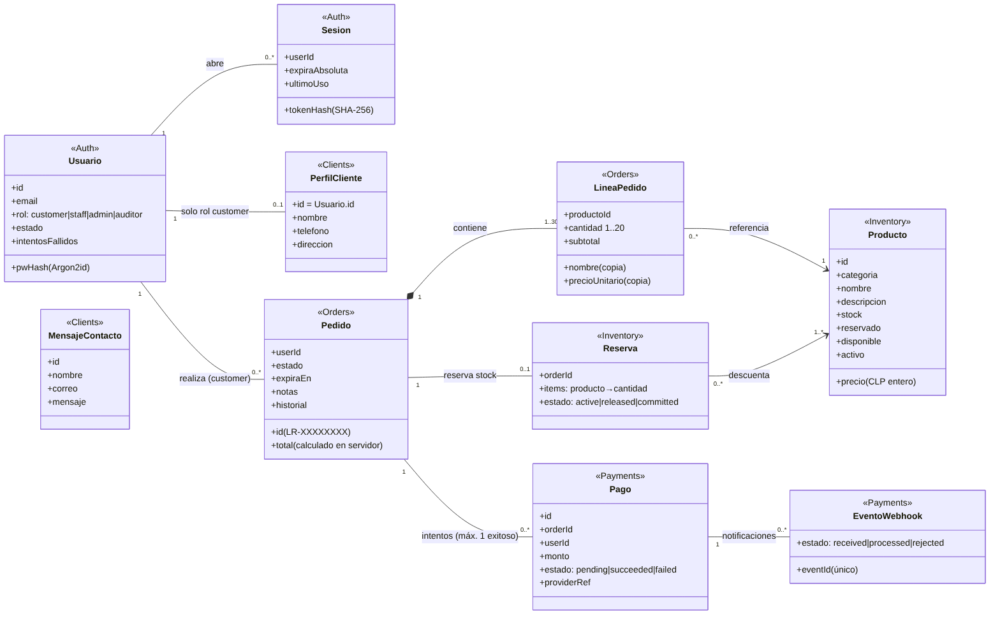
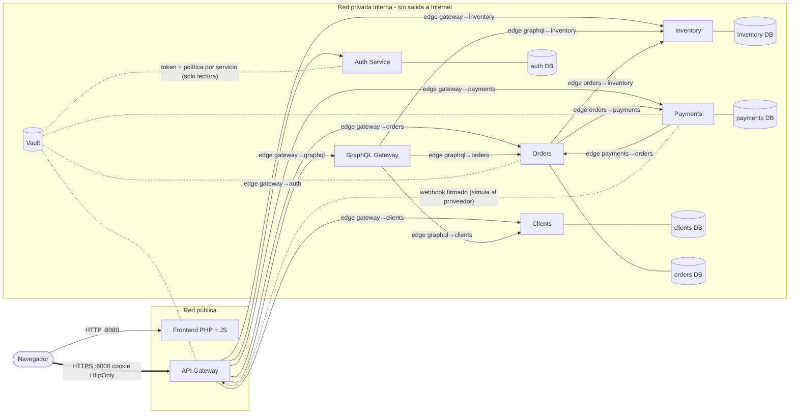
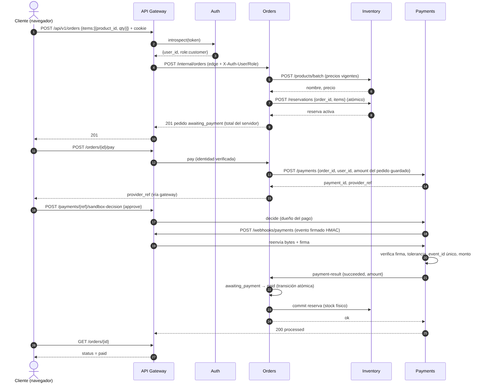
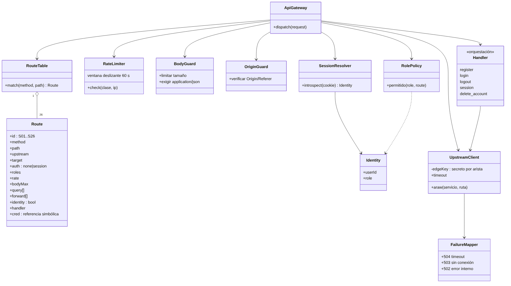
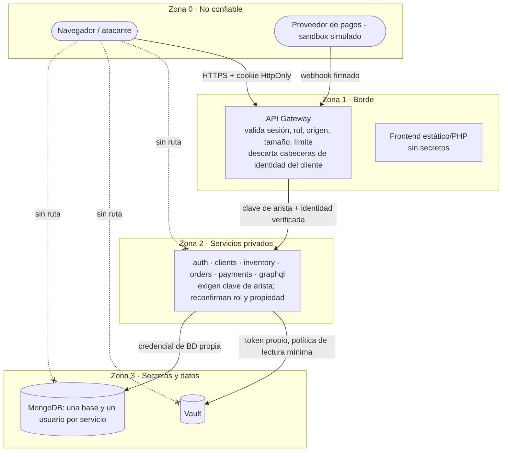

# Evaluación 2 · Diseño e implementación de un backend seguro completo

**Caso:** Libre & Rico (panadería/pastelería sin gluten, venta web con retiro en tienda) · **Unidad 2** · Desarrollo Web y Móvil

**Equipo (integrante único):** Matías Palma Santana · **Fecha:** 09-11-2026

**Versión del front-end integrada:** sitio PHP + Bootstrap + JavaScript del repositorio `dwm20260203` (commit base `f481908`), extendido en esta entrega con `assets/js/{api,cuenta,productos,pago,pedidos,admin}.js` y las pantallas `productos.php`, `pago.php`, `mis-pedidos.php`, `admin.php`, `contacto.php`. El archivo `api-dummy.js` (datos simulados) fue **eliminado**: todas las pantallas consumen el backend real.

## Qué se entrega

| Pieza | Dónde |
|---|---|
| Código de 7 servicios (gateway, auth, clients, inventory, orders, payments, graphql) | `backend/` |
| Front-end integrado | `frontend/` |
| Despliegue reproducible (docker compose + Vault + MongoDB) | `deploy/`, `scripts/vault_bootstrap.py` |
| Ejecución local sin Docker (para pruebas) | `scripts/dev_local.py` |
| Pruebas automatizadas, de navegador y de carga | `tests/`, `scripts/carga.py` |
| Informe por módulo (este documento) y evidencias | `docs/`, `docs/evidencia/` |

## Brechas entre el front-end original y el backend (y cómo se cerraron)

| # | Brecha encontrada en el front-end original | Resolución |
|---|---|---|
| B1 | Catálogo, precios y stock salían de datos simulados en el navegador | Catálogo desde `inventory` vía `GET /api/v1/products` (S01); el total mostrado lo calcula el servidor |
| B2 | No existía cuenta ni sesión | Registro/ingreso/salida con cookie `HttpOnly` (S03–S06); el menú se dibuja según la sesión, pero la autorización real está en servidor |
| B3 | El «pago» y el estado del pedido se decidían en el navegador | El navegador solo abre la intención de pago; **«pagado» solo lo fija un resultado firmado del proveedor** que `orders` verifica (S14, S18, S19) |
| B4 | Formulario de contacto sin destino | `POST /contact` con validación y límite de frecuencia (S10); lectura solo para personal (S11) |
| B5 | Sin historial ni panel de operación | «Mis pedidos» y «Panel» consumen GraphQL, que agrega orders + inventory + clients (S20) |
| B6 | Sin administración de inventario | Pantalla de inventario con roles (S21–S24) |
| B7 | Datos se insertaban sin cuidado de XSS | Todo dato del servidor se inserta con `textContent`; no hay `innerHTML` con datos |

## Limitaciones declaradas (lo que NO se ejecutó o NO se afirma)

* **Docker, Vault y MongoDB reales no se ejecutaron en el entorno de desarrollo** (el entorno no tenía demonio de Docker ni acceso para descargar los binarios). El `docker-compose.yml` fue validado sintácticamente con `docker compose config`. Todas las pruebas se ejecutaron con **procesos reales** de cada servicio, pero la base fue **mongomock en memoria** y el cliente de Vault se probó contra un **servidor Vault KV v2 falso**. Por tanto, la persistencia real y el arranque con contenedores están **sin probar**; deben comprobarse en la máquina de demostración con la lista del Módulo 10.
* El proveedor de pagos es un **sandbox simulado** dentro de `payments` (no hay cuenta real); su protocolo de firma sí es el que se usaría con uno real.
* El limitador de solicitudes es en memoria de proceso: válido para **una instancia** de gateway.
* No se configuró TLS: en producción va un proxy con HTTPS y `LR_COOKIE_SECURE=1`.
* Las mediciones de carga son de un entorno de desarrollo (2 vCPU, base en memoria), no de producción.
* Los usuarios y datos de prueba son **ficticios**; ninguna contraseña está en el repositorio (se generan en `deploy/.env`, que no se versiona).

---

# Módulo 1 · Servicios y contratos

## Servicios y responsabilidades

| Servicio | Puerto | Responsabilidad | Base propia | Expuesto al navegador |
|---|---:|---|---|---|
| API Gateway | 8000 | Único punto de entrada: sesión, rol, origen, tamaño, límite, enrutamiento y traducción de errores | no | **sí** (también el webhook del proveedor) |
| Auth | 8001 | Cuentas, contraseñas (Argon2id), sesiones, bloqueo por intentos | `auth` | no |
| Clients | 8002 | Perfil del cliente y mensajes de contacto | `clients` | no |
| Inventory | 8003 | Catálogo, stock y reservas atómicas | `inventory` | no |
| Orders | 8004 | Pedidos, precios del servidor, estados, expiración, idempotencia | `orders` | no |
| Payments | 8005 | Intención de pago, sandbox, webhook firmado | `payments` | no |
| GraphQL | 8006 | Agregación de lectura sin base propia | no | no (solo vía gateway) |

## Matriz de servicios (26 operaciones externas)

Generada desde `backend/gateway/routes.py`, que es la tabla que el gateway ejecuta: lo documentado es lo implementado.

| ID | Requisito | Pantalla y acción | Propósito | Verbo y ruta | Entrada | Salida y errores | Clasificación | Acceso |
|---|---|---|---|---|---|---|---|---|
| S01 | RF1 RF2 | P01 · cargar catálogo / filtrar | Consultar catálogo | `GET /api/v1/products` (Consultar) | query: categoria?, q?, available?, limit 1-100, offset ≥0 | 200 {items[{id,categoria,emoji,nombre,descripcion,precio,disponible}],total,categorias}; 400 invalid_filter; 429 | Público | anónimo |
| S02 | RF1 | P01 · detalle de producto | Consultar un producto | `GET /api/v1/products/{product_id}` (Consultar) | ruta: product_id | 200 producto; 404 | Público | anónimo |
| S03 | RF6 | P02 · crear cuenta | Registrar cliente y abrir sesión | `POST /api/v1/auth/register` (Agregar/acción) | body: email, password 10-128, nombre 2-80, telefono? | 201 {user:{id,email,role}} + cookie; 400 validation_error; 409 email_taken; 429 | Credencial + dato personal | anónimo |
| S04 | RF6 | P02 · ingresar | Autenticar | `POST /api/v1/auth/login` (Agregar/acción) | body: email, password | 200 {user} + cookie HttpOnly; 401 invalid_credentials; 429 too_many_attempts | Credencial | anónimo |
| S05 | RF6 | Menú de cuenta · cerrar sesión | Revocar la sesión | `POST /api/v1/auth/logout` (Agregar/acción) | cookie | 204 (cookie borrada); 401 | Credencial | autenticado (Cliente, Personal, Admin., Auditoría) |
| S06 | RF6 | Todas · estado de sesión | Saber quién soy | `GET /api/v1/auth/session` (Consultar) | cookie | 200 {user_id,role,email}; 401 | Dato personal (correo) | autenticado (Cliente, Personal, Admin., Auditoría) |
| S07 | RF8 | P04 · perfil | Consultar mi perfil | `GET /api/v1/clients/me` (Consultar) | cookie | 200 {id,nombre,telefono,direccion}; 404 | Dato personal restringido | autenticado (Cliente) |
| S08 | RF8 | P04 · guardar perfil | Modificar mi perfil | `PUT /api/v1/clients/me` (Modificar) | body: nombre?, telefono?, direccion? | 200 perfil; 400 validation_error/empty_update | Dato personal restringido | autenticado (Cliente) |
| S09 | RF8 | P04 · eliminar cuenta | Eliminar perfil y credenciales; anonimizar pedidos | `DELETE /api/v1/account` (Eliminar) | cookie | 204; 401 | Dato personal restringido | autenticado (Cliente) |
| S10 | RF11 | P06 · enviar mensaje | Registrar mensaje de contacto | `POST /api/v1/contact` (Agregar/acción) | body: nombre, correo, mensaje 5-1000 | 201 {id,status}; 400; 429 | Dato personal (correo) | anónimo |
| S11 | RF11 RF9 | P05 · pestaña Mensajes | Leer mensajes de contacto | `GET /api/v1/admin/contact` (Consultar) | query: limit ≤50 | 200 {items}; 403 | Dato personal | autenticado (Personal, Admin.) |
| S12 | RF3 RF4 | P01 · Confirmar y pagar | Crear pedido y reservar stock | `POST /api/v1/orders` (Agregar/acción) | header Idempotency-Key?; body: items[{product_id, qty 1-20}] (1-30 líneas), notes? | 201 pedido {id,status:awaiting_payment,total,items,expires_at}; 400 duplicate_items/validation; 409 insufficient_stock/product_unavailable; 503 | Dato comercial del cliente | autenticado (Cliente) |
| S13 | RF7 RF5 | P03 pago / P04 historial | Consultar un pedido | `GET /api/v1/orders/{order_id}` (Consultar) | ruta: order_id | 200 pedido; 404 (también si es ajeno) | Dato comercial del cliente | autenticado (Cliente, Personal, Admin., Auditoría) |
| S14 | RF5 | P01/P04 · Pagar | Abrir intención de pago por el total guardado | `POST /api/v1/orders/{order_id}/pay` (Agregar/acción) | ruta: order_id | 200 {order_id,payment_id,provider_ref,amount}; 409 invalid_state/order_expired; 404 | Dato comercial | autenticado (Cliente) |
| S15 | RF7 | P04 · Cancelar | Cancelar un pedido pendiente y liberar stock | `POST /api/v1/orders/{order_id}/cancel` (Agregar/acción) | ruta: order_id | 200 pedido; 409 invalid_state; 404 | Dato comercial | autenticado (Cliente, Personal, Admin.) |
| S16 | RF9 | P05 · avanzar estado | Preparar → listo → entregar | `POST /api/v1/admin/orders/{order_id}/status` (Agregar/acción) | body: status ∈ {preparing,ready,delivered} | 200 pedido; 409 invalid_transition; 403 | Dato comercial | autenticado (Personal, Admin.) |
| S17 | RF5 | P03 · cargar pago | Consultar un pago propio | `GET /api/v1/payments/{provider_ref}` (Consultar) | ruta: provider_ref | 200 {payment_id,order_id,amount,currency,status}; 404 | Dato comercial | autenticado (Cliente) |
| S18 | RF5 | P03 · Aprobar/Rechazar (sandbox) | Simular la pantalla del proveedor | `POST /api/v1/payments/{provider_ref}/sandbox-decision` (Agregar/acción) | body: outcome ∈ {approve,reject} | 200 {event_id,webhook_status}; 404; 409 invalid_state | Dato comercial | autenticado (Cliente) |
| S19 | RF5 | — (lo llama el proveedor) | Recibir resultado del pago | `POST /api/v1/webhooks/payments` (Agregar/acción) | header X-Provider-Signature; body {event_id,type,provider_ref,amount} | 200 {processed\|duplicate\|ignored\|duplicate_payment}; 401 invalid_signature; 400 amount_mismatch/validation | Dato comercial | anónimo |
| S20 | RF7 RF9 RF12 | P04 · Mis pedidos / P05 · panel | Agregar datos de varios servicios | `POST /api/v1/graphql` (Agregar/acción) | body: query, variables | 200 {data,errors}; errores parciales con extensions.code | Según campo (ver Módulo 8) | autenticado (Cliente, Personal, Admin., Auditoría) |
| S21 | RF10 | P05 · pestaña Inventario | Listar productos con stock | `GET /api/v1/admin/products` (Consultar) | query: categoria?, q?, limit, offset | 200 {items con stock/reservado/disponible_unidades}; 403 | Dato interno | autenticado (Personal, Admin.) |
| S22 | RF10 | P05 · Crear producto | Agregar producto al catálogo | `POST /api/v1/admin/products` (Agregar/acción) | body: id, categoria, emoji?, nombre, descripcion, precio>0, stock≥0 | 201 producto; 409 product_exists; 400; 403 | Público tras crear | autenticado (Admin.) |
| S23 | RF10 | P05 · editar producto | Modificar nombre/descripcion/precio/activo | `PUT /api/v1/admin/products/{product_id}` (Modificar) | body: campos opcionales | 200 producto; 400; 404; 403 | Público | autenticado (Admin.) |
| S24 | RF10 | P05 · Guardar stock | Ajustar stock físico | `PUT /api/v1/admin/products/{product_id}/stock` (Modificar) | body: stock 0-100000 | 200 producto; 409 stock_below_reserved; 404; 403 | Dato interno | autenticado (Personal, Admin.) |
| S25 | RF13 | (API) · alta de personal | Crear cuentas de personal, auditoría o administración | `POST /api/v1/admin/users` (Agregar/acción) | body: email, password, role ∈ {staff,auditor,admin} | 201 {user_id,role}; 409 email_taken; 403 | Credencial | autenticado (Admin.) |
| S26 | RF4 | (API) · mantenimiento | Expirar pedidos vencidos y liberar stock | `POST /api/v1/admin/maintenance/sweep` (Agregar/acción) | — | 200 {expired,released_retried,commits_retried}; 403 | Dato interno | autenticado (Admin.) |

## Formato común de contratos

* JSON (UTF-8); fechas ISO-8601 en UTC con `Z`; dinero en **pesos chilenos enteros** (sin decimales).
* Todo error tiene la misma forma: `{"error": {"code": "...", "message": "...", "correlation_id": "...", "details": [...]}}`. Los mensajes no revelan detalles internos ni distinguen «correo inexistente» de «clave errónea».
* Cada respuesta lleva `X-Correlation-Id`, que aparece en los registros de todos los servicios implicados.

## Ejemplos de contratos (S12 crear pedido, S14 pagar, S20 GraphQL)

**S12 · `POST /api/v1/orders`** — cabecera opcional `Idempotency-Key`

```json
{ "items": [ {"product_id": "p01", "qty": 2}, {"product_id": "p03", "qty": 1} ], "notes": "retiro tarde" }
```

Respuesta `201` (precios y total los calcula el servidor; el cliente no envía ninguno):

```json
{ "id": "LR-F1E40D4B", "status": "awaiting_payment", "total": 9370, "currency": "CLP",
  "expires_at": "2026-11-09T18:30:00Z",
  "items": [ {"product_id":"p01","nombre":"Pan de molde","qty":2,"unit_price":3190,"subtotal":6380},
             {"product_id":"p03","nombre":"Hallulla sin gluten","qty":1,"unit_price":2990,"subtotal":2990} ] }
```

Errores: `400 duplicate_items | validation_error` · `401` · `403` (rol no cliente) · `409 insufficient_stock | product_unavailable` · `429 rate_limited` · `503 upstream_unavailable`.

**S14 · `POST /api/v1/orders/{id}/pay`** (sin cuerpo) → `200 {"order_id","payment_id","provider_ref","amount"}`; el monto sale del pedido guardado, nunca de la solicitud.

**S19 · `POST /api/v1/webhooks/payments`** (lo llama el proveedor) — cabecera `X-Provider-Signature: t=<epoch>,v1=<hmac-sha256(secreto, "<t>." + cuerpo)>`; cuerpo `{"event_id","type","provider_ref","amount"}`. Respuestas: `200 processed|duplicate|ignored`, `401 invalid_signature`, `400 amount_mismatch`.

**S20 · `POST /api/v1/graphql`** — ver Módulo 8, con ejemplos reales de consulta y respuesta.

---

# Módulo 2 · Dominio, UML y reglas de negocio



Fuente editable: `docs/diagramas/dominio.mmd`. Cada entidad está marcada con el servicio dueño; **ningún servicio lee la base de otro**.

## Cardinalidades y su justificación

| Relación | Cardinalidad | Regla que la justifica |
|---|---|---|
| Usuario – Sesión | 1 a 0..* | Varias sesiones simultáneas (dispositivos); cada una se revoca por separado |
| Usuario – PerfilCliente | 1 a 0..1 | Solo el rol `customer` tiene perfil; el personal no lo necesita |
| Usuario – Pedido | 1 a 0..* | Un cliente puede tener muchos pedidos; al eliminar la cuenta los pedidos se **anonimizan** (se conservan por contabilidad) |
| Pedido – LineaPedido | 1 a 1..30 (composición) | Un pedido sin líneas no existe; máximo 30 líneas, cantidad 1–20, sin productos repetidos |
| LineaPedido – Producto | 0..* a 1 | La línea **copia** nombre y precio al crear el pedido: cambiar el precio después no altera pedidos existentes |
| Pedido – Reserva | 1 a 0..1 | Una reserva por pedido (idempotente por `order_id`) |
| Pedido – Pago | 1 a 0..* | Se permiten reintentos tras un rechazo; **como máximo un pago exitoso** |
| Pago – EventoWebhook | 1 a 0..* | `event_id` único: el mismo evento no se procesa dos veces |

## Reglas de negocio (RN)

| # | Regla | Dónde se aplica | Prueba |
|---|---|---|---|
| RN1 | Precios y total los calcula el servidor desde el catálogo vigente | orders | `test_V6_*`, `test_flujo_completo_*` |
| RN2 | Reserva atómica: `disponible ≥ cantidad` en todas las líneas o ninguna (compensación) | inventory | `test_concurrencia_*`, `test_stock_insuficiente_*` |
| RN3 | Un pedido sin pago vence a los 15 min (configurable) y libera su stock | orders | `test_expiracion_*` |
| RN4 | Pedido: `pending_reservation → awaiting_payment → paid → preparing → ready → delivered`; ramas `rejected`, `expired`, `cancelled`, `refund_required` | orders | `test_flujo_completo_*` |
| RN5 | Un pago que llega **después** de expirar el pedido lo marca `refund_required`; no se entrega | orders | `test_expiracion_*` |
| RN6 | Solo un resultado firmado, vigente (±300 s), de monto exacto y evento no repetido puede confirmar un pago | payments + orders | `test_V6_*` |
| RN7 | Un cliente solo ve sus pedidos; uno ajeno responde 404 (no revela su existencia) | orders | `test_V4_*` |
| RN8 | El rol lo guarda el servidor; el registro público siempre crea `customer` | auth | `test_registro_login_logout_y_cookie_segura`, `test_V3_*` |
| RN9 | La misma `Idempotency-Key` devuelve el mismo pedido; no se duplica | orders | `test_idempotency_key_*` |
| RN10 | El stock físico no puede bajar de lo reservado | inventory | `test_stock_fisico_no_baja_de_lo_reservado` |
| RN11 | Eliminar la cuenta borra perfil y credenciales y anonimiza pedidos | clients/auth/orders | `test_eliminar_cuenta_*` |

---

# Módulo 3 · Matriz de sistemas, mapa de componentes y secuencia

## Matriz de sistemas

| Sistema | Tipo | Quién lo llama | A quién llama | Protocolo | Credencial |
|---|---|---|---|---|---|
| Navegador | cliente externo | — | Gateway | HTTP/JSON + cookie `HttpOnly` | sesión del usuario |
| Proveedor de pagos (sandbox) | externo | — | Gateway (webhook) | HTTP + firma HMAC | `payments/webhook` |
| API Gateway | borde propio | navegador, proveedor | auth, clients, inventory, orders, payments, graphql | HTTP/JSON | `edge/gateway__*` |
| Auth | interno | gateway | — | HTTP/JSON | `edge/gateway__auth` |
| Clients | interno | gateway, graphql | — | HTTP/JSON | `edge/gateway__clients`, `edge/graphql__clients` |
| Inventory | interno | gateway, orders, graphql | — | HTTP/JSON | `edge/gateway__inventory`, `edge/orders__inventory`, `edge/graphql__inventory` |
| Orders | interno | gateway, payments, graphql | inventory, payments | HTTP/JSON | `edge/gateway__orders`, `edge/payments__orders`, `edge/graphql__orders` |
| Payments | interno | gateway, orders | orders | HTTP/JSON | `edge/gateway__payments`, `edge/orders__payments` |
| GraphQL | interno | gateway | orders, inventory, clients | HTTP/JSON (lectura) | `edge/gateway__graphql` |
| Vault | infraestructura | todos los servicios | — | HTTPS/JSON | token propio por servicio |
| MongoDB | infraestructura | los 5 servicios con datos | — | MongoDB wire (`mongodb://…`) | usuario propio por servicio |

La lista de aristas sale de `scripts/topology.py` (única fuente de verdad): de ella se generan el inventario de secretos, las políticas de Vault y las claves del arranque.

## Mapa de componentes



## Secuencia: compra, pago y confirmación



Puntos de diseño visibles en la secuencia: (1) el navegador nunca envía precio ni estado; (2) `orders` obtiene los precios de `inventory` en el momento; (3) el monto del pago sale del pedido guardado; (4) el «pagado» llega por un evento firmado, verificado dos veces (firma/monto/duplicado en `payments`; monto otra vez en `orders`); (5) `commit` de la reserva descuenta el stock físico solo al confirmar.

---

# Módulo 4 · Actores y matriz de permisos

## Actores

| Actor | Rol técnico | Qué necesita | Qué NO debe poder hacer |
|---|---|---|---|
| Visitante | anónimo | ver catálogo, crear cuenta, escribir al contacto | ver pedidos, perfiles, stock exacto |
| Cliente | `customer` | comprar, pagar, ver/cancelar **sus** pedidos, gestionar **su** perfil | ver pedidos o datos de otros, cambiar precios/estados, administrar |
| Personal de tienda | `staff` | ver pedidos, avanzar preparación, ajustar stock, leer contacto | crear productos o cuentas; ver la dirección del cliente |
| Administración | `admin` | todo lo del personal + productos + altas de personal | pagar por un cliente; ver credenciales |
| Auditoría | `auditor` | ver pedidos y panel (solo lectura) | ver datos personales; modificar nada |
| Proveedor de pagos | sistema externo | notificar resultados | cualquier cosa fuera del webhook firmado |
| Equipo de operación | persona con acceso a infraestructura | desplegar, rotar secretos | leer secretos de otros servicios (cada uno tiene política de solo lectura propia) |

## Matriz de permisos por ruta, verbo y condición

✔ permitido · 401 requiere sesión · 403 rol sin permiso. La columna final es la condición **dentro** del servicio dueño (el gateway no la puede verificar sola).

| ID | Verbo y ruta | Anónimo | Cliente | Personal | Admin. | Auditoría | Condición adicional (propiedad / campo) |
|---|---|---|---|---|---|---|---|
| S01 | `GET /api/v1/products` | ✔ | ✔ | ✔ | ✔ | ✔ | — |
| S02 | `GET /api/v1/products/{product_id}` | ✔ | ✔ | ✔ | ✔ | ✔ | — |
| S03 | `POST /api/v1/auth/register` | ✔ | ✔ | ✔ | ✔ | ✔ | El rol lo fija el servidor (customer) |
| S04 | `POST /api/v1/auth/login` | ✔ | ✔ | ✔ | ✔ | ✔ | — |
| S05 | `POST /api/v1/auth/logout` | 401 | ✔ | ✔ | ✔ | ✔ | Solo su propia sesión |
| S06 | `GET /api/v1/auth/session` | 401 | ✔ | ✔ | ✔ | ✔ | Solo la propia |
| S07 | `GET /api/v1/clients/me` | 401 | ✔ | 403 | 403 | 403 | id = sesión |
| S08 | `PUT /api/v1/clients/me` | 401 | ✔ | 403 | 403 | 403 | id = sesión |
| S09 | `DELETE /api/v1/account` | 401 | ✔ | 403 | 403 | 403 | Solo la propia cuenta |
| S10 | `POST /api/v1/contact` | ✔ | ✔ | ✔ | ✔ | ✔ | — |
| S11 | `GET /api/v1/admin/contact` | 401 | 403 | ✔ | ✔ | 403 | Solo personal/administración |
| S12 | `POST /api/v1/orders` | 401 | ✔ | 403 | 403 | 403 | customer: pedido a nombre de la sesión |
| S13 | `GET /api/v1/orders/{order_id}` | 401 | ✔ | ✔ | ✔ | ✔ | Dueño; personal/admin/auditoría ven todos (auditoría sin identidad) |
| S14 | `POST /api/v1/orders/{order_id}/pay` | 401 | ✔ | 403 | 403 | 403 | Dueño del pedido |
| S15 | `POST /api/v1/orders/{order_id}/cancel` | 401 | ✔ | ✔ | ✔ | 403 | Dueño; personal/admin |
| S16 | `POST /api/v1/admin/orders/{order_id}/status` | 401 | 403 | ✔ | ✔ | 403 | Personal/administración |
| S17 | `GET /api/v1/payments/{provider_ref}` | 401 | ✔ | 403 | 403 | 403 | Dueño del pago |
| S18 | `POST /api/v1/payments/{provider_ref}/sandbox-decision` | 401 | ✔ | 403 | 403 | 403 | Dueño del pago |
| S19 | `POST /api/v1/webhooks/payments` | ✔ | ✔ | ✔ | ✔ | ✔ | Autenticada por firma, no por usuario |
| S20 | `POST /api/v1/graphql` | 401 | ✔ | ✔ | ✔ | ✔ | Por recurso y campo en cada servicio |
| S21 | `GET /api/v1/admin/products` | 401 | 403 | ✔ | ✔ | 403 | Personal/administración |
| S22 | `POST /api/v1/admin/products` | 401 | 403 | 403 | ✔ | 403 | Solo administración |
| S23 | `PUT /api/v1/admin/products/{product_id}` | 401 | 403 | 403 | ✔ | 403 | Solo administración |
| S24 | `PUT /api/v1/admin/products/{product_id}/stock` | 401 | 403 | ✔ | ✔ | 403 | Personal/administración |
| S25 | `POST /api/v1/admin/users` | 401 | 403 | 403 | ✔ | 403 | Solo administración |
| S26 | `POST /api/v1/admin/maintenance/sweep` | 401 | 403 | 403 | ✔ | 403 | Solo administración |

**Defensa en profundidad:** el gateway filtra por rol (primera capa) y el servicio dueño **vuelve a verificar** rol y propiedad con la identidad que le llega firmada por clave de arista (segunda capa). Un servicio privado rechaza llamadas sin clave de arista (401) y descarta cualquier `X-Auth-User/Role` que no venga del gateway o de graphql.

---

# Módulo 5 · API Gateway: UML y fronteras de confianza

## Diseño del gateway



Orden fijo de controles por solicitud (`backend/gateway/main.py`):

1. **Tabla de rutas explícita** (`routes.py`, S01–S26): lo que no está en la tabla responde 404/405; no existe «reenviar todo lo que empiece con /api».
2. **Límite de solicitudes** por clase de ruta e IP (login 20/min, contacto 5/min, escritura 60/min, públicas 240/min; configurables) → `429` con `retry_after`.
3. **Tamaño de cuerpo** máximo por ruta y `Content-Type: application/json` obligatorio → `413`/`415`.
4. **Origen (CSRF):** en métodos que modifican, `Origin`/`Referer` debe estar en la lista permitida; además la cookie es `SameSite=Lax`.
5. **Sesión:** la cookie `lr_session` se introspecciona en Auth en cada solicitud; el rol se lee **del usuario**, no de la sesión (un cambio de rol surte efecto de inmediato).
6. **Política de rol** por ruta → `401`/`403`.
7. **Reenvío mínimo:** solo cabeceras en lista blanca por ruta; se descartan `X-Auth-*` que traiga el cliente y se inyectan los verificados; se añade la clave de arista (`edge/gateway__<destino>`).
8. **Traducción de fallos:** `504` si el destino no responde a tiempo, `503` si no hay conexión, `502` si falla internamente; los 5xx controlados del destino (con `code`) se propagan sin exponer detalles.
9. **Cabeceras de seguridad** (`X-Content-Type-Options`, `Cache-Control: no-store`, etc.) y **CORS** con lista de orígenes explícita y `credentials`.

La cookie de sesión es `HttpOnly`, `SameSite=Lax`, `Path=/` y `Secure` cuando `LR_COOKIE_SECURE=1` (obligatorio tras TLS). El gateway **no almacena datos**: solo orquesta registro/ingreso/salida/eliminación de cuenta (Auth + Clients + Orders).

## Fronteras de confianza



| Frontera | Qué cruza | Control en la frontera |
|---|---|---|
| Z0 → Z1 (Internet → gateway) | todas las solicitudes del navegador y el webhook | tabla de rutas, límites, origen, sesión, rol, validación de tamaño y tipo |
| Z1 → Z2 (gateway → servicios) | solicitud + identidad verificada | clave de arista por llamador→destino (`hmac.compare_digest`); el servicio **re-verifica** rol y propiedad; identidad aceptada solo de gateway/graphql |
| Z2 → Z2 (servicio → servicio) | orders↔inventory, orders↔payments, graphql→(orders, inventory, clients) | solo las aristas listadas en `topology.py`; el resto devuelve 401 |
| Z2 → Z3 (servicios → Vault/Mongo) | secretos y datos | token de Vault de solo lectura por servicio; usuario de Mongo `readWrite` solo sobre su base |
| Webhook (Z0 → Z1 → payments) | evento del proveedor | firma HMAC-SHA256, tolerancia ±300 s, `event_id` único, monto exacto |

**Sin ruta (líneas punteadas):** desde Z0 no hay camino a servicios privados, MongoDB ni Vault: en compose solo se publican los puertos 8000 (gateway) y 8080 (front-end); la red `private` es `internal: true`. La prueba `test_V5_acceso_directo_al_backend_sin_identidad` verifica que llamar directo a un servicio sin identidad/clave falla.

---

# Módulo 6 · Matriz de rutas, inventario de secretos y operaciones GraphQL

## Matriz de rutas (gateway → servicio)

Generada desde `routes.py`. «Referencia de credencial» es el nombre simbólico en Vault; **ningún valor aparece en el repositorio ni en este informe**.

| ID | Gateway | Verbo | Ruta externa | Acceso y rol | Sistema y ruta destino | Controles | Referencia de credencial |
|---|---|---|---|---|---|---|---|
| S01 | Gateway externo | GET | `/api/v1/products` | anónimo | inventory: `GET /internal/products` | límite «public»; cuerpo ≤ 4096 B; filtros validados (400), paginación acotada, solo campos de catálogo | edge/gateway__inventory |
| S02 | Gateway externo | GET | `/api/v1/products/{product_id}` | anónimo | inventory: `GET /internal/products/{product_id}` | límite «public»; cuerpo ≤ 4096 B; id acotado a [A-Za-z0-9_.-]{1,80} | edge/gateway__inventory |
| S03 | Gateway externo | POST | `/api/v1/auth/register` | anónimo | orquestación en gateway (`register`) | límite «login»; cuerpo ≤ 1024 B; el rol nunca viene del cliente; compensación si falla clients | edge/gateway__auth, edge/gateway__clients |
| S04 | Gateway externo | POST | `/api/v1/auth/login` | anónimo | orquestación en gateway (`login`) | límite «login»; cuerpo ≤ 512 B; bloqueo por intentos, cookie HttpOnly, token jamás en el cuerpo | edge/gateway__auth |
| S05 | Gateway externo | POST | `/api/v1/auth/logout` | sesión · Cliente, Personal, Admin., Auditoría | orquestación en gateway (`logout`) | límite «auth»; cuerpo ≤ 0 B; revocación inmediata de la sesión | edge/gateway__auth |
| S06 | Gateway externo | GET | `/api/v1/auth/session` | sesión · Cliente, Personal, Admin., Auditoría | orquestación en gateway (`session`) | límite «auth»; cuerpo ≤ 4096 B; validación en el servicio | edge/gateway__auth |
| S07 | Gateway externo | GET | `/api/v1/clients/me` | sesión · Cliente | clients: `GET /internal/clients/me` | límite «auth»; cuerpo ≤ 4096 B; el id sale de la sesión, no de la URL | edge/gateway__clients |
| S08 | Gateway externo | PUT | `/api/v1/clients/me` | sesión · Cliente | clients: `PUT /internal/clients/me` | límite «auth»; cuerpo ≤ 1024 B; solo campos permitidos; validación en el servicio | edge/gateway__clients |
| S09 | Gateway externo | DELETE | `/api/v1/account` | sesión · Cliente | orquestación en gateway (`delete_account`) | límite «auth»; cuerpo ≤ 0 B; elimina perfil y credenciales; anonimiza pedidos | edge/gateway__orders, edge/gateway__clients, edge/gateway__auth |
| S10 | Gateway externo | POST | `/api/v1/contact` | anónimo | clients: `POST /internal/contact` | límite «contact»; cuerpo ≤ 2048 B; límite estricto por IP | edge/gateway__clients |
| S11 | Gateway externo | GET | `/api/v1/admin/contact` | sesión · Personal, Admin. | clients: `GET /internal/contact` | límite «auth»; cuerpo ≤ 4096 B; validación en el servicio | edge/gateway__clients |
| S12 | Gateway externo | POST | `/api/v1/orders` | sesión · Cliente | orders: `POST /internal/orders` | límite «write»; cuerpo ≤ 4096 B; precios y total los calcula el servidor; Idempotency-Key | edge/gateway__orders |
| S13 | Gateway externo | GET | `/api/v1/orders/{order_id}` | sesión · Cliente, Personal, Admin., Auditoría | orders: `GET /internal/orders/{order_id}` | límite «auth»; cuerpo ≤ 4096 B; propiedad del pedido verificada en orders (404 si es ajeno) | edge/gateway__orders |
| S14 | Gateway externo | POST | `/api/v1/orders/{order_id}/pay` | sesión · Cliente | orders: `POST /internal/orders/{order_id}/pay` | límite «write»; cuerpo ≤ 0 B; monto tomado del pedido guardado | edge/gateway__orders |
| S15 | Gateway externo | POST | `/api/v1/orders/{order_id}/cancel` | sesión · Cliente, Personal, Admin. | orders: `POST /internal/orders/{order_id}/cancel` | límite «write»; cuerpo ≤ 0 B; validación en el servicio | edge/gateway__orders |
| S16 | Gateway externo | POST | `/api/v1/admin/orders/{order_id}/status` | sesión · Personal, Admin. | orders: `POST /internal/orders/{order_id}/status` | límite «write»; cuerpo ≤ 256 B; máquina de estados en orders | edge/gateway__orders |
| S17 | Gateway externo | GET | `/api/v1/payments/{provider_ref}` | sesión · Cliente | payments: `GET /internal/payments/by-ref/{provider_ref}` | límite «auth»; cuerpo ≤ 4096 B; solo el dueño del pago | edge/gateway__payments |
| S18 | Gateway externo | POST | `/api/v1/payments/{provider_ref}/sandbox-decision` | sesión · Cliente | payments: `POST /internal/sandbox/{provider_ref}/decide` | límite «write»; cuerpo ≤ 128 B; simula la pantalla del proveedor; NO confirma el pago (lo hace el webhook firmado) | edge/gateway__payments |
| S19 | Gateway externo | POST | `/api/v1/webhooks/payments` | anónimo | payments: `POST /internal/webhooks/provider` | límite «webhook»; cuerpo ≤ 2048 B; firma HMAC con marca de tiempo, event_id único, verificación de monto | edge/gateway__payments + payments/webhook |
| S20 | Gateway externo | POST | `/api/v1/graphql` | sesión · Cliente, Personal, Admin., Auditoría | graphql: `POST /graphql` | límite «auth»; cuerpo ≤ 4096 B; límites de profundidad/alias/tokens; autorización por campo en cada servicio | edge/gateway__graphql |
| S21 | Gateway externo | GET | `/api/v1/admin/products` | sesión · Personal, Admin. | inventory: `GET /internal/products` | límite «auth»; cuerpo ≤ 4096 B; incluye stock (vista de personal) | edge/gateway__inventory |
| S22 | Gateway externo | POST | `/api/v1/admin/products` | sesión · Admin. | inventory: `POST /internal/products` | límite «auth»; cuerpo ≤ 1024 B; validación en el servicio | edge/gateway__inventory |
| S23 | Gateway externo | PUT | `/api/v1/admin/products/{product_id}` | sesión · Admin. | inventory: `PUT /internal/products/{product_id}` | límite «auth»; cuerpo ≤ 1024 B; validación en el servicio | edge/gateway__inventory |
| S24 | Gateway externo | PUT | `/api/v1/admin/products/{product_id}/stock` | sesión · Personal, Admin. | inventory: `PUT /internal/products/{product_id}/stock` | límite «auth»; cuerpo ≤ 128 B; validación en el servicio | edge/gateway__inventory |
| S25 | Gateway externo | POST | `/api/v1/admin/users` | sesión · Admin. | auth: `POST /internal/users` | límite «auth»; cuerpo ≤ 512 B; crea personal/auditoría; solo administración | edge/gateway__auth |
| S26 | Gateway externo | POST | `/api/v1/admin/maintenance/sweep` | sesión · Admin. | orders: `POST /internal/orders/maintenance/sweep` | límite «auth»; cuerpo ≤ 0 B; expira pedidos y libera stock | edge/gateway__orders |

## Inventario de secretos (referencias simbólicas)

Generado desde `scripts/topology.py`. Los valores los crea `vault_bootstrap.py` al azar (256 bits) y solo se guardan en Vault. En ejecución local sin Vault se entregan por variables de entorno `LR_SECRET__<REF>__<CAMPO>` creadas al vuelo y no persistidas.

| Referencia | Tipo | Emisor | Consumidor | Finalidad | Ubicación segura | Alcance | Rotación y revocación |
|---|---|---|---|---|---|---|---|
| `edge/gateway__auth` | clave de servicio (256 bits aleatorios) | bootstrap de Vault | gateway la presenta; auth la verifica | identificar a `gateway` ante `auth` | Vault KV `secret/lr/edge/gateway__auth` | solo las rutas que `auth` permite a `gateway` | rotar: borrar el secreto y repetir bootstrap, reiniciar gateway y auth; revocar: borrarlo (b rechaza con 401) |
| `edge/gateway__clients` | clave de servicio (256 bits aleatorios) | bootstrap de Vault | gateway la presenta; clients la verifica | identificar a `gateway` ante `clients` | Vault KV `secret/lr/edge/gateway__clients` | solo las rutas que `clients` permite a `gateway` | rotar: borrar el secreto y repetir bootstrap, reiniciar gateway y clients; revocar: borrarlo (b rechaza con 401) |
| `edge/gateway__inventory` | clave de servicio (256 bits aleatorios) | bootstrap de Vault | gateway la presenta; inventory la verifica | identificar a `gateway` ante `inventory` | Vault KV `secret/lr/edge/gateway__inventory` | solo las rutas que `inventory` permite a `gateway` | rotar: borrar el secreto y repetir bootstrap, reiniciar gateway y inventory; revocar: borrarlo (b rechaza con 401) |
| `edge/gateway__orders` | clave de servicio (256 bits aleatorios) | bootstrap de Vault | gateway la presenta; orders la verifica | identificar a `gateway` ante `orders` | Vault KV `secret/lr/edge/gateway__orders` | solo las rutas que `orders` permite a `gateway` | rotar: borrar el secreto y repetir bootstrap, reiniciar gateway y orders; revocar: borrarlo (b rechaza con 401) |
| `edge/gateway__payments` | clave de servicio (256 bits aleatorios) | bootstrap de Vault | gateway la presenta; payments la verifica | identificar a `gateway` ante `payments` | Vault KV `secret/lr/edge/gateway__payments` | solo las rutas que `payments` permite a `gateway` | rotar: borrar el secreto y repetir bootstrap, reiniciar gateway y payments; revocar: borrarlo (b rechaza con 401) |
| `edge/gateway__graphql` | clave de servicio (256 bits aleatorios) | bootstrap de Vault | gateway la presenta; graphql la verifica | identificar a `gateway` ante `graphql` | Vault KV `secret/lr/edge/gateway__graphql` | solo las rutas que `graphql` permite a `gateway` | rotar: borrar el secreto y repetir bootstrap, reiniciar gateway y graphql; revocar: borrarlo (b rechaza con 401) |
| `edge/orders__inventory` | clave de servicio (256 bits aleatorios) | bootstrap de Vault | orders la presenta; inventory la verifica | identificar a `orders` ante `inventory` | Vault KV `secret/lr/edge/orders__inventory` | solo las rutas que `inventory` permite a `orders` | rotar: borrar el secreto y repetir bootstrap, reiniciar orders y inventory; revocar: borrarlo (b rechaza con 401) |
| `edge/orders__payments` | clave de servicio (256 bits aleatorios) | bootstrap de Vault | orders la presenta; payments la verifica | identificar a `orders` ante `payments` | Vault KV `secret/lr/edge/orders__payments` | solo las rutas que `payments` permite a `orders` | rotar: borrar el secreto y repetir bootstrap, reiniciar orders y payments; revocar: borrarlo (b rechaza con 401) |
| `edge/payments__orders` | clave de servicio (256 bits aleatorios) | bootstrap de Vault | payments la presenta; orders la verifica | identificar a `payments` ante `orders` | Vault KV `secret/lr/edge/payments__orders` | solo las rutas que `orders` permite a `payments` | rotar: borrar el secreto y repetir bootstrap, reiniciar payments y orders; revocar: borrarlo (b rechaza con 401) |
| `edge/graphql__orders` | clave de servicio (256 bits aleatorios) | bootstrap de Vault | graphql la presenta; orders la verifica | identificar a `graphql` ante `orders` | Vault KV `secret/lr/edge/graphql__orders` | solo las rutas que `orders` permite a `graphql` | rotar: borrar el secreto y repetir bootstrap, reiniciar graphql y orders; revocar: borrarlo (b rechaza con 401) |
| `edge/graphql__inventory` | clave de servicio (256 bits aleatorios) | bootstrap de Vault | graphql la presenta; inventory la verifica | identificar a `graphql` ante `inventory` | Vault KV `secret/lr/edge/graphql__inventory` | solo las rutas que `inventory` permite a `graphql` | rotar: borrar el secreto y repetir bootstrap, reiniciar graphql y inventory; revocar: borrarlo (b rechaza con 401) |
| `edge/graphql__clients` | clave de servicio (256 bits aleatorios) | bootstrap de Vault | graphql la presenta; clients la verifica | identificar a `graphql` ante `clients` | Vault KV `secret/lr/edge/graphql__clients` | solo las rutas que `clients` permite a `graphql` | rotar: borrar el secreto y repetir bootstrap, reiniciar graphql y clients; revocar: borrarlo (b rechaza con 401) |
| `db/auth` | credencial de base de datos | bootstrap (usuario Mongo `svc_auth`) | auth | conexión de `auth` a su base `auth` | Vault KV `secret/lr/db/auth` | readWrite solo sobre la base `auth` | rotar: repetir bootstrap (updateUser); revocar: eliminar usuario Mongo |
| `db/clients` | credencial de base de datos | bootstrap (usuario Mongo `svc_clients`) | clients | conexión de `clients` a su base `clients` | Vault KV `secret/lr/db/clients` | readWrite solo sobre la base `clients` | rotar: repetir bootstrap (updateUser); revocar: eliminar usuario Mongo |
| `db/inventory` | credencial de base de datos | bootstrap (usuario Mongo `svc_inventory`) | inventory | conexión de `inventory` a su base `inventory` | Vault KV `secret/lr/db/inventory` | readWrite solo sobre la base `inventory` | rotar: repetir bootstrap (updateUser); revocar: eliminar usuario Mongo |
| `db/orders` | credencial de base de datos | bootstrap (usuario Mongo `svc_orders`) | orders | conexión de `orders` a su base `orders` | Vault KV `secret/lr/db/orders` | readWrite solo sobre la base `orders` | rotar: repetir bootstrap (updateUser); revocar: eliminar usuario Mongo |
| `db/payments` | credencial de base de datos | bootstrap (usuario Mongo `svc_payments`) | payments | conexión de `payments` a su base `payments` | Vault KV `secret/lr/db/payments` | readWrite solo sobre la base `payments` | rotar: repetir bootstrap (updateUser); revocar: eliminar usuario Mongo |
| `payments/webhook` | secreto de firma de webhooks (HMAC-SHA256) | bootstrap (con proveedor real: panel del proveedor) | payments (verifica y, en sandbox, firma) | autenticar eventos del proveedor de pagos | Vault KV `secret/lr/payments/webhook` | solo `payments`; el navegador nunca lo recibe | rotar: nuevo secreto + ventana de doble verificación; revocar: eliminarlo (webhooks pasan a 401) |
| `vault/token/<servicio>` | token de Vault con política de solo lectura | bootstrap (token raíz solo en el contenedor bootstrap) | cada servicio, su propio token | leer únicamente sus referencias | volumen de Docker montado solo en ese servicio (`/run/token/token`) | política `lr-<servicio>`: capabilities=[read] sobre sus rutas | TTL 720 h; en producción AppRole/identidad de plataforma con renovación; revocar: `vault token revoke` |
| `cookie lr_session` | credencial del USUARIO (token de sesión opaco) | Auth Service al iniciar sesión | gateway (la valida con Auth) | sesión del navegador | navegador: cookie HttpOnly; servidor: SHA-256 en la base de Auth | el rol del usuario | inactividad 30 min, absoluta 8 h; revocada al cerrar sesión o eliminar cuenta |

**Comportamiento ante fallas del gestor de secretos** (`lr_common/secrets.py`, probado en `test_04_cliente_vault`): caché con TTL corto; si Vault no responde se usa el **último valor conocido hasta `LR_SECRET_STALE_MAX` segundos** y luego se **falla cerrado** (503 `secrets_unavailable`); nunca se cae a un valor por defecto.

## Operaciones GraphQL

Un único punto externo (`POST /api/v1/graphql`, S20) hacia el servicio `graphql`, que **no tiene base de datos** y llama a los servicios dueños con la identidad del usuario.

| Operación | Tipo | Quién | Fuentes | Autorización |
|---|---|---|---|---|
| `yo` | query | cualquier sesión | identidad + clients | el perfil solo para `customer` (el suyo) |
| `pedidos(primeros, desplazamiento, estado)` | query | cliente (los suyos), personal/admin/auditoría (todos) | orders (+ inventory por línea, + clients por campo `cliente`) | filtrado en `orders`; `cliente` solo staff/admin |
| `resumenPedido(id)` | query | dueño o personal | orders (+ inventory) | `orders` responde 404 si es ajeno |
| `panelOperacion` | query | staff, admin, auditor | orders (`$group`) + inventory (bajo stock) | rol en graphql y en cada servicio; `productosBajoStock` puede fallar parcialmente |
| mutaciones | — | — | **no existen**: toda escritura es REST con validación propia | — |

---

# Módulo 7 · Datos sensibles, secretos de cliente y validaciones

## Clasificación de datos

| Dato | Clasificación | Dueño | Dónde se guarda | Quién lo ve | Tratamiento |
|---|---|---|---|---|---|
| Contraseña | **Credencial** | Auth | solo hash Argon2id | nadie | nunca se devuelve ni se registra; comparación de tiempo constante |
| Token de sesión | **Credencial** | Auth | SHA-256 del token (el original solo viaja en cookie `HttpOnly`) | el propio navegador (sin acceso por JS) | inactividad 30 min, absoluta 8 h, revocable |
| Claves de arista, de BD, de webhook | **Secreto de sistema** | Vault | Vault KV v2 | cada servicio, solo las suyas | rotables; nunca en repositorio, imagen ni logs |
| Correo, nombre, teléfono, dirección | **Dato personal restringido** | Auth/Clients | bases propias | el titular; personal (nombre/teléfono); admin (+dirección); auditoría: nada | minimización por rol; eliminación a solicitud |
| Pedidos y pagos | **Dato comercial del cliente** | Orders/Payments | bases propias | dueño y personal/admin/auditoría | 404 ante pedido ajeno; anonimización al borrar cuenta |
| Mensajes de contacto | **Dato personal** | Clients | base propia | solo personal/admin | límite de frecuencia y tamaño |
| Catálogo y precios | **Público** | Inventory | base propia | todos | stock exacto solo para personal |
| Stock exacto y reservas | **Interno** | Inventory | base propia | personal/admin | — |
| Registros (logs) | **Operacional** | cada servicio | salida estándar | operación | JSON con redacción de claves sensibles y sin cuerpos de solicitud (`test_los_logs_no_contienen_*`) |

## Decisión: ¿se custodian secretos del cliente?

**No.** El sistema no guarda ni procesa **datos de tarjeta** (ni PAN, ni CVV): el cliente paga en la pantalla del proveedor y el backend solo recibe el resultado firmado y una referencia (`provider_ref`). La única credencial del cliente es su contraseña, que se guarda **solo como hash Argon2id** (con sal propia, parámetros por defecto de `argon2-cffi`) y nunca es recuperable. Se evita así el alcance de PCI-DSS sobre datos de tarjeta y no existe ningún «secreto del cliente» que cifrar para poder devolverlo. Si el negocio exigiera guardar tarjetas, debería hacerse con tokenización del proveedor, no en este sistema.

## Ciclo de vida de un dato restringido (dirección del cliente)

| Etapa | Qué ocurre |
|---|---|
| Captura | el cliente la escribe en «Mi perfil»; validada (5–160 caracteres) y enviada por HTTPS al gateway |
| Uso | `GET /clients/me` (solo el titular) o, para administración, vía GraphQL `cliente`; el personal no recibe el campo |
| Almacenamiento | solo en la base `clients` (usuario Mongo propio); ningún otro servicio la copia |
| Registro | no aparece en logs (redacción de campos) |
| Eliminación | `DELETE /account`: borra perfil y credenciales y anonimiza los pedidos |

## Resultados de validación

Las pruebas **V1–V6** son las validaciones pedidas para este módulo; el resto cubre el comportamiento restante. Tabla completa generada desde `junit.xml` (ejecutada con `python scripts/generar_docs.py --pruebas`):

**37/37 pruebas OK** (fuente: `docs/evidencia/junit.xml`, generado por pytest).

| Prueba | Qué verifica (entrada · identidad · esperado · componente) | Resultado | Tiempo |
|---|---|---|---|
| `test_01_validacion_modulo7::test_V1_acceso_anonimo_al_catalogo` | V1 · entrada: GET /products · identidad: anónimo · esperado: 200 con campos de catálogo, sin stock exacto. | OK | 3.24 s |
| `test_01_validacion_modulo7::test_V2_operacion_protegida_sin_sesion` | V2 · entrada: POST /orders, GET /clients/me, POST /graphql · identidad: sin cookie · esperado: 401. | OK | 0.01 s |
| `test_01_validacion_modulo7::test_V2b_cookie_invalida_es_401` | V2b cookie invalida es 401 | OK | 0.03 s |
| `test_01_validacion_modulo7::test_V3_administracion_con_rol_sin_permiso` | V3 · entrada: operaciones de administración · identidad: customer/staff/auditor · esperado: 403. | OK | 0.51 s |
| `test_01_validacion_modulo7::test_V4_pedido_ajeno_no_devuelve_datos` | V4 · entrada: GET /orders/{id} y resumenPedido(id) · identidad: Beto sobre pedido de Ana · esperado: 404 sin datos; | OK | 0.32 s |
| `test_01_validacion_modulo7::test_V5_acceso_directo_al_backend_sin_identidad` | V5 · entrada: llamadas directas a los puertos de servicios privados · identidad: ninguna / clave falsa / cabeceras | OK | 0.15 s |
| `test_01_validacion_modulo7::test_V6_confirmar_pago_con_datos_alterados` | V6 · entrada: precio/total/estado alterados en la solicitud, endpoints de 'confirmación' inventados, webhooks falsificados, | OK | 0.38 s |
| `test_02_flujos_y_reglas::test_registro_login_logout_y_cookie_segura` | registro login logout y cookie segura | OK | 0.45 s |
| `test_02_flujos_y_reglas::test_login_generico_y_bloqueo_por_intentos` | login generico y bloqueo por intentos | OK | 6.68 s |
| `test_02_flujos_y_reglas::test_csrf_origen_y_tipo_de_contenido` | csrf origen y tipo de contenido | OK | 0.04 s |
| `test_02_flujos_y_reglas::test_rutas_inexistentes_y_verbos_no_permitidos` | rutas inexistentes y verbos no permitidos | OK | 0.02 s |
| `test_02_flujos_y_reglas::test_formulario_de_contacto_y_limite_de_solicitudes` | formulario de contacto y limite de solicitudes | OK | 0.06 s |
| `test_02_flujos_y_reglas::test_flujo_completo_pedido_pago_y_preparacion` | flujo completo pedido pago y preparacion | OK | 0.18 s |
| `test_02_flujos_y_reglas::test_pago_rechazado_conserva_pedido_y_permite_reintento` | pago rechazado conserva pedido y permite reintento | OK | 0.15 s |
| `test_02_flujos_y_reglas::test_cancelar_libera_el_stock` | cancelar libera el stock | OK | 0.07 s |
| `test_02_flujos_y_reglas::test_stock_insuficiente_y_validaciones_del_pedido` | stock insuficiente y validaciones del pedido | OK | 0.09 s |
| `test_02_flujos_y_reglas::test_concurrencia_no_se_vende_mas_de_lo_que_hay` | concurrencia no se vende mas de lo que hay | OK | 0.12 s |
| `test_02_flujos_y_reglas::test_idempotency_key_no_duplica_pedidos` | idempotency key no duplica pedidos | OK | 0.05 s |
| `test_02_flujos_y_reglas::test_expiracion_libera_stock_y_pago_tardio_requiere_reembolso` | expiracion libera stock y pago tardio requiere reembolso | OK | 6.66 s |
| `test_02_flujos_y_reglas::test_panel_de_administracion_y_productos` | panel de administracion y productos | OK | 0.30 s |
| `test_02_flujos_y_reglas::test_eliminar_cuenta_borra_perfil_y_anonimiza_pedidos` | eliminar cuenta borra perfil y anonimiza pedidos | OK | 0.44 s |
| `test_02_flujos_y_reglas::test_los_logs_no_contienen_credenciales_ni_datos_personales` | los logs no contienen credenciales ni datos personales | OK | 0.00 s |
| `test_02_flujos_y_reglas::test_filtros_del_catalogo_texto_y_disponibilidad` | RF2 · entrada: GET /products con q, categoria y available · identidad: anónimo · esperado: solo coincidencias; agotados se excluyen con available=true. | OK | 0.04 s |
| `test_02_flujos_y_reglas::test_stock_fisico_no_baja_de_lo_reservado` | RN10 · entrada: ajuste de stock menor que lo reservado · identidad: personal · esperado: 409 stock_below_reserved; igual a lo reservado, 200. | OK | 0.06 s |
| `test_03_graphql::test_agregacion_pedidos_con_productos_vigentes` | agregacion pedidos con productos vigentes | OK | 0.06 s |
| `test_03_graphql::test_cliente_ve_solo_lo_suyo_y_no_el_campo_cliente` | cliente ve solo lo suyo y no el campo cliente | OK | 0.07 s |
| `test_03_graphql::test_personal_ve_clientes_y_auditoria_no` | personal ve clientes y auditoria no | OK | 0.08 s |
| `test_03_graphql::test_panel_operacion_agrega_orders_e_inventory` | panel operacion agrega orders e inventory | OK | 0.05 s |
| `test_03_graphql::test_limites_de_consulta` | limites de consulta | OK | 0.06 s |
| `test_04_cliente_vault::test_lee_secreto_con_token_del_servicio_y_cachea` | lee secreto con token del servicio y cachea | OK | 0.52 s |
| `test_04_cliente_vault::test_politica_de_minimo_privilegio` | politica de minimo privilegio | OK | 0.52 s |
| `test_04_cliente_vault::test_gestor_caido_usa_ultimo_valor_conocido_y_luego_falla_cerrado` | gestor caido usa ultimo valor conocido y luego falla cerrado | OK | 1.24 s |
| `test_04_cliente_vault::test_politicas_generadas_por_servicio` | politicas generadas por servicio | OK | 0.00 s |
| `test_99_resiliencia::test_inventory_caido_degrada_de_forma_controlada` | inventory caido degrada de forma controlada | OK | 0.88 s |
| `test_99_resiliencia::test_orders_caido_da_503_y_se_recupera` | orders caido da 503 y se recupera | OK | 0.90 s |
| `test_99_resiliencia::test_auth_caido_falla_cerrado` | auth caido falla cerrado | OK | 1.52 s |
| `test_99_resiliencia::test_limite_de_profundidad_graphql` | El esquema actual llega a profundidad 5; se reinicia graphql con límite 3 para probar el rechazo. | OK | 2.09 s |

Pruebas de navegador (Playwright contra el front-end real): ver `docs/evidencia/resultados-navegador.json` y las capturas en `docs/evidencia/capturas/`.

---

# Módulo 8 · Servicios privados y GraphQL

## Qué es privado y por qué

| Servicio | Accesible desde Internet | Por qué |
|---|---|---|
| gateway | **sí** (puerto 8000) | único punto de entrada |
| auth, clients, inventory, orders, payments, graphql | no | solo alcanzables desde la red interna con clave de arista |
| mongo, vault | no | solo desde servicios con credenciales propias |

En `deploy/docker-compose.yml` solo se publican `8000` y `8080` (front-end). La red `private` es `internal: true`.

## Esquema GraphQL (resumen)

```graphql
type Query {
  yo: Yo!
  resumenPedido(id: ID!): Pedido!
  pedidos(primeros: Int = 10, desplazamiento: Int = 0, estado: String): PaginaPedidos!
  panelOperacion: PanelOperacion!
}
type Pedido { id estado total moneda creado expira estadoPago requiereReembolso notas clienteRef lineas: [LineaPedido!]! cliente: Cliente }
type LineaPedido { productoId nombre cantidad precioUnitario subtotal producto: Producto }   # producto = datos VIGENTES (inventory)
type Cliente { id nombre telefono direccion }                                                 # según rol
type PanelOperacion { pedidosPorEstado: [EstadoConteo!]! ventasPagadas: Int! productosBajoStock: [ProductoBajoStock!] }
```

**Resolvers y fuentes:** `pedidos`/`resumenPedido` → orders; `LineaPedido.producto` → inventory (DataLoader por lote: una llamada por consulta, no una por línea); `Pedido.cliente` → clients (DataLoader, `/clients/batch`); `panelOperacion` → orders (`$group` en la base) + inventory. El servicio **no tiene base propia**.

## Autorización por campo

| Campo | Cliente | Personal | Admin | Auditoría |
|---|---|---|---|---|
| `pedidos` / `resumenPedido` | solo los suyos | todos | todos | todos (sin identidad del cliente) |
| `Pedido.cliente` | error `forbidden` en ese campo | nombre y teléfono | + dirección | error `forbidden` |
| `panelOperacion.pedidosPorEstado/ventas` | `forbidden` | ✔ | ✔ | ✔ |
| `panelOperacion.productosBajoStock` | `forbidden` | ✔ | ✔ | error parcial (campo `null`) |

La regla vive en el servicio dueño; GraphQL **no decide por su cuenta**, solo propaga la identidad verificada. Los errores son **parciales**: el resto de la respuesta se entrega y el campo fallido sale `null` con `extensions.code`.

## Límites de consulta (defensa contra consultas abusivas)

Profundidad máx. 6, alias máx. 4, tokens máx. 600, introspección desactivada (`LR_GQL_INTROSPECTION=1` solo en desarrollo), `primeros` entre 1 y 50, errores inesperados enmascarados (los de validación y autorización conservan su mensaje). Probado en `test_limites_de_consulta` y `test_limite_de_profundidad_graphql`.

## Evidencia de agregación desde el front-end

* «Mis pedidos» (`pedidos.js`) y el panel (`admin.js`) hacen **una** llamada a `/graphql`; el navegador no consulta orders e inventory por separado. Verificado por la prueba de navegador «P04 Mis pedidos (GraphQL) lista el pedido pagado con productos» y la captura `capturas/05-mis-pedidos-1280.png`.
* Ejemplos **reales** de consulta y respuesta (incluido el error parcial por rol y el pedido ajeno → 404): `docs/evidencia/ejemplos-graphql.md`, generado con `python scripts/ejemplos_graphql.py`.

# Ejemplos reales de GraphQL (Módulo 8)

Generado por `python scripts/ejemplos_graphql.py` contra el stack local; los ids y montos son de esa ejecución.

## 1. Cliente (Ana) consulta sus pedidos: agrega orders + inventory; el campo `cliente` queda prohibido

```graphql
query {
  pedidos(primeros: 2) {
    total
    items { id estado total lineas { nombre cantidad subtotal producto { precio disponible } } cliente { nombre } }
  }
}
```
```json
{
  "data": {
    "pedidos": {
      "total": 1,
      "items": [
        {
          "id": "LR-F1E40D4B",
          "estado": "awaiting_payment",
          "total": 9370,
          "lineas": [
            {
              "nombre": "Pan de molde",
              "cantidad": 2,
              "subtotal": 6380,
              "producto": {
                "precio": 3190,
                "disponible": true
              }
            },
            {
              "nombre": "Hallulla sin gluten",
              "cantidad": 1,
              "subtotal": 2990,
              "producto": {
                "precio": 2990,
                "disponible": true
              }
            }
          ],
          "cliente": null
        }
      ]
    }
  },
  "errors": [
    {
      "message": "Tu rol no puede consultar datos del cliente.",
      "locations": [
        {
          "line": 4,
          "column": 96
        }
      ],
      "path": [
        "pedidos",
        "items",
        0,
        "cliente"
      ],
      "extensions": {
        "code": "forbidden",
        "status": 403
      }
    }
  ]
}
```

## 2. Personal consulta los mismos pedidos: ahora sí ve `cliente` (clients), sin dirección

```graphql
query {
  pedidos(primeros: 2) {
    total
    items { id estado total lineas { nombre cantidad subtotal producto { precio disponible } } cliente { nombre } }
  }
}
```
```json
{
  "data": {
    "pedidos": {
      "total": 1,
      "items": [
        {
          "id": "LR-F1E40D4B",
          "estado": "awaiting_payment",
          "total": 9370,
          "lineas": [
            {
              "nombre": "Pan de molde",
              "cantidad": 2,
              "subtotal": 6380,
              "producto": {
                "precio": 3190,
                "disponible": true
              }
            },
            {
              "nombre": "Hallulla sin gluten",
              "cantidad": 1,
              "subtotal": 2990,
              "producto": {
                "precio": 2990,
                "disponible": true
              }
            }
          ],
          "cliente": {
            "nombre": "Ana Pérez (ficticia)"
          }
        }
      ]
    }
  }
}
```

## 3. Otro cliente (Beto) pide el pedido de Ana por id

```graphql
query { resumenPedido(id: "LR-F1E40D4B") { id total } }
```
```json
{
  "data": null,
  "errors": [
    {
      "message": "Pedido no encontrado.",
      "locations": [
        {
          "line": 1,
          "column": 9
        }
      ],
      "path": [
        "resumenPedido"
      ],
      "extensions": {
        "code": "not_found",
        "status": 404
      }
    }
  ]
}
```

## 4. Auditoría pide el panel: pedidos y ventas sí; bajo stock → error parcial si el rol no lo permite

```graphql
query { panelOperacion { pedidosPorEstado { estado cantidad } ventasPagadas productosBajoStock { nombre unidadesDisponibles } } }
```
```json
{
  "data": {
    "panelOperacion": {
      "pedidosPorEstado": [
        {
          "estado": "awaiting_payment",
          "cantidad": 1
        }
      ],
      "ventasPagadas": 0,
      "productosBajoStock": null
    }
  },
  "errors": [
    {
      "message": "Tu rol no permite esta operación.",
      "locations": [
        {
          "line": 1,
          "column": 77
        }
      ],
      "path": [
        "panelOperacion",
        "productosBajoStock"
      ],
      "extensions": {
        "code": "forbidden",
        "status": 403
      }
    }
  ]
}
```

## 5. Personal pide el panel completo (orders + inventory)

```graphql
query { panelOperacion { pedidosPorEstado { estado cantidad } ventasPagadas productosBajoStock { nombre unidadesDisponibles } } }
```
```json
{
  "data": {
    "panelOperacion": {
      "pedidosPorEstado": [
        {
          "estado": "awaiting_payment",
          "cantidad": 1
        }
      ],
      "ventasPagadas": 0,
      "productosBajoStock": []
    }
  }
}
```

---

# Módulo 9 · ADR-001 · Analítica separada y gRPC: no se adoptan (por ahora)

**Estado:** aceptada · **Fecha:** 09-11-2026 · **Decide:** Matías Palma Santana

## Contexto

Libre & Rico es una panadería con venta web de retiro en tienda. La **carga proyectada** (supuesto declarado, no medido en producción): ~200 pedidos/día, pico ~30 pedidos/hora, ~20 clientes simultáneos, ~73 000 pedidos/año. Se evaluó (a) un servicio de **analítica separado** (almacén/ETL propio) y (b) **gRPC** para la comunicación interna.

## Decisión

1. **No se crea un servicio de analítica separado.** Las necesidades actuales (pedidos por estado, ventas pagadas, productos con bajo stock) se resuelven con **agregación en la base de `orders` (`$group`)** a través de GraphQL (`panelOperacion`).
2. **No se adopta gRPC.** La comunicación interna sigue en HTTP/JSON con claves por arista.

## Justificación con mediciones

Medición en entorno de desarrollo (2 vCPU, base en memoria; método y limitaciones en `docs/evidencia/carga.md`), 25 clientes concurrentes —más del doble de lo proyectado—:

| Operación | p95 medido | Objetivo p95 |
|---|---:|---:|
| Catálogo | 133 ms | 300 ms |
| GraphQL pedidos+productos | 436 ms | 500 ms |
| Crear pedido | 489 ms | 800 ms |
| Pagar | 353 ms | 800 ms |
| Confirmar pago (webhook→payments→orders→inventory) | 570 ms | 1500 ms |
| Panel con **5 000 pedidos** | 237 ms | 1000 ms |

Todos los objetivos se cumplen con 0 errores. El tráfico proyectado (≈ una solicitud cada pocos segundos en el pico) es muy inferior al medido (cientos por segundo en lectura). El panel es lineal en el número de pedidos: 5 000 pedidos ≈ 25 días de operación; el año completo (~73 000) es una **extrapolación NO medida**.

**gRPC** reduce latencia/serialización en llamadas internas de alto volumen; aquí cada pedido implica pocas llamadas internas y el tiempo se reparte entre varias, sin un cuello de botella de transporte que justifique perder la simplicidad de depuración (JSON legible, mismos errores y correlación) y añadir contratos `.proto`, generación de código y balanceo HTTP/2.

**Analítica separada** se justificaría por consultas históricas pesadas, cruces multi-fuente o impacto en la base transaccional. Hoy no ocurre: una sola consulta agregada sobre un volumen pequeño.

## Consecuencias

* (+) Menos piezas que operar, asegurar y desplegar; mismo modelo de errores, trazas y claves en todo el sistema.
* (−) Si crece el volumen o aparecen informes históricos, el panel se degradará linealmente.
* (−) El proveedor de pagos real puede añadir latencia que esta medición (sandbox local) no captura.

## Condiciones para revisar la decisión

* p95 del panel > 1 s con el volumen real, o > 5 000 pedidos/día sostenidos.
* Necesidad de informes históricos/cohortes sin afectar la base transaccional → analítica separada (réplica de lectura o almacén).
* Más de ~10 llamadas internas por solicitud externa o CPU dominada por (de)serialización → evaluar gRPC en esas aristas.

## Alternativas descartadas

| Alternativa | Motivo |
|---|---|
| Servicio de analítica con ETL | coste operativo sin necesidad actual |
| gRPC en todas las aristas | complejidad sin cuello de botella medido |
| Cache de agregados | añade invalidación; no necesario con p95 237 ms |

## Carga medida (copia)

# Reporte de carga (Módulo 9)

**Tipo de dato: MEDICIÓN** en el stack local de desarrollo (ver limitaciones). Los objetivos son una **proyección** declarada antes de medir.

## Entorno y método

- Máquina: Linux-6.18.44-fc-v338-x86_64-with-glibc2.39, 2 vCPU, 7.8 GiB RAM; Python 3.13.18.
- Sistema: 7 procesos (gateway, auth, clients, inventory, orders, payments, graphql) con base **mongomock en memoria** (sin red ni disco).
- Generador de carga en la misma máquina: 25 clientes concurrentes con sesión propia; 12 s por fase; límites de solicitudes del gateway desactivados.
- Datos: 12 productos con stock alto; pedidos creados por la propia fase de escritura (entre 1 y 3 líneas).
- Reproducir: `python scripts/carga.py --segundos 12 --concurrencia 25`.

## Resultados vs objetivos

| Operación | n | req/s | p50 ms | p95 ms | p99 ms | errores | objetivo p95 | veredicto |
|---|---:|---:|---:|---:|---:|---:|---:|---|
| GET /products (anónimo) | 3845 | 320.1 | 73 | 133 | 163 | 0 | 300 | cumple |
| POST /graphql pedidos+productos | 946 | 78.1 | 324 | 436 | 485 | 0 | 500 | cumple |
| POST /orders | 337 | 27.2 | 254 | 489 | 527 | 0 | 800 | cumple |
| POST /orders/{id}/pay | 337 | 27.2 | 247 | 353 | 406 | 0 | 800 | cumple |
| POST sandbox-decision (webhook→payments→orders→inventory) | 337 | 27.2 | 387 | 570 | 669 | 0 | 1500 | cumple |
| POST /graphql panelOperacion (agregación, ver volumen) | 30 | — | 201 | 237 | 278 | 0 | 1000 | cumple |

Pedidos totales en la base al medir el panel: **5000** (proyección: ~200/día ≈ 73 000/año; este volumen equivale a ~25 días; la agregación es lineal en el número de pedidos, así que el año completo es una extrapolación NO medida).

## CPU y memoria por proceso

| Proceso | CPU media % | CPU máx % | RSS máx MiB |
|---|---:|---:|---:|
| gateway | 27 | 81 | 68 |
| auth | 16 | 150 | 130 |
| clients | 0 | 2 | 66 |
| inventory | 31 | 60 | 75 |
| orders | 59 | 94 | 117 |
| payments | 6 | 94 | 125 |
| graphql | 6 | 76 | 76 |
| **suma de servicios** | 145 | 184 | — |

(100 % = un núcleo completo; el generador de carga no está incluido en la tabla.)

## Limitaciones

- mongomock no refleja la latencia de MongoDB real (red, disco, índices): las cifras de base de datos son **optimistas**.
- Generador y sistema comparten CPU: las latencias son **pesimistas** por esa competencia. Ambos sesgos se compensan solo en parte.
- Una sola ejecución sin calentamiento dedicado; no hay intervalos de confianza. Repetir en el entorno de despliegue real antes de afirmar capacidad de producción.
- Fuera de alcance de la medición: red entre contenedores, TLS, Vault real (el cliente de secretos cachea 5 min).

---

# Módulo 10 · Backend completo, integración y demostración

## Trazabilidad requisito → pantalla → servicio → prueba → resultado → evidencia

Generada por `python scripts/generar_docs.py` a partir de `docs/evidencia/junit.xml` y `resultados-navegador.json`: los resultados no se escriben a mano.

Pantallas: **P01** `productos.php` · **P02** modal de acceso (todas las páginas) · **P03** `pago.php` · **P04** `mis-pedidos.php` · **P05** `admin.php` · **P06** `contacto.php`.

| Req. | Requisito | Pantalla | Servicio · ruta | Prueba | Resultado | Evidencia (docs/evidencia/) |
|---|---|---|---|---|---|---|
| RF1 | Ver el catálogo de productos (precios y disponibilidad vigentes) | P01 Productos | inventory · S01 S02 | `test_V1_acceso_anonimo_al_catalogo`<br>`test_agregacion_pedidos_con_productos_vigentes`<br>navegador: P01 catálogo muestra 12 productos desde la API | 2/2 pytest; 1/1 navegador | capturas/01-catalogo-1280.png, 08-catalogo-360.png |
| RF2 | Filtrar por categoría / texto / disponibilidad | P01 Productos | inventory · S01 | `test_filtros_del_catalogo_texto_y_disponibilidad`<br>`test_rutas_inexistentes_y_verbos_no_permitidos` | 2/2 pytest | resultados-pruebas.md |
| RF3 | Crear un pedido con precios y total calculados por el servidor | P01 Productos → P03 Pago | orders+inventory · S12 | `test_V6_confirmar_pago_con_datos_alterados`<br>`test_flujo_completo_pedido_pago_y_preparacion`<br>`test_idempotency_key_no_duplica_pedidos`<br>`test_stock_insuficiente_y_validaciones_del_pedido`<br>navegador: P01 total del pedido en pantalla | 4/4 pytest; 1/1 navegador | capturas/03-pago-sandbox-1280.png |
| RF4 | Reservar stock sin sobreventa; liberar al cancelar o vencer | P01 / P04 | inventory+orders · S12 S15 S26 | `test_cancelar_libera_el_stock`<br>`test_concurrencia_no_se_vende_mas_de_lo_que_hay`<br>`test_expiracion_libera_stock_y_pago_tardio_requiere_reembolso`<br>`test_stock_fisico_no_baja_de_lo_reservado` | 4/4 pytest | resultados-pruebas.md |
| RF5 | Pagar y confirmar por resultado firmado del proveedor (el navegador no decide «pagado») | P03 Pago | payments+orders · S14 S17 S18 S19 | `test_V6_confirmar_pago_con_datos_alterados`<br>`test_flujo_completo_pedido_pago_y_preparacion`<br>`test_pago_rechazado_conserva_pedido_y_permite_reintento`<br>navegador: P03 pantalla de pago muestra total calculado por el servidor<br>navegador: P03 pago aprobado se confirma por webhook y el pedido queda 'Pagado' | 3/3 pytest; 2/2 navegador | capturas/03-pago-sandbox-1280.png, 04-pago-confirmado.png |
| RF6 | Crear cuenta, iniciar y cerrar sesión de forma segura | P02 Acceso | auth · S03 S04 S05 S06 | `test_V2_operacion_protegida_sin_sesion`<br>`test_V2b_cookie_invalida_es_401`<br>`test_auth_caido_falla_cerrado`<br>`test_csrf_origen_y_tipo_de_contenido`<br>`test_login_generico_y_bloqueo_por_intentos`<br>`test_registro_login_logout_y_cookie_segura`<br>navegador: P02 sin sesión se abre el modal de acceso<br>navegador: P02 registro crea sesión (menú de cuenta visible)<br>navegador: Cookie de sesión HttpOnly y no legible por JS | 6/6 pytest; 3/3 navegador | capturas/02-modal-acceso.png |
| RF7 | Consultar y cancelar mis pedidos (solo los míos) | P04 Mis pedidos | orders+graphql · S13 S15 S20 | `test_V4_pedido_ajeno_no_devuelve_datos`<br>`test_agregacion_pedidos_con_productos_vigentes`<br>`test_cancelar_libera_el_stock`<br>`test_cliente_ve_solo_lo_suyo_y_no_el_campo_cliente`<br>navegador: P04 Mis pedidos (GraphQL) lista el pedido pagado con productos | 4/4 pytest; 1/1 navegador | capturas/05-mis-pedidos-1280.png |
| RF8 | Ver, editar y eliminar mi perfil | P04 Mi perfil | clients+auth+orders · S07 S08 S09 | `test_eliminar_cuenta_borra_perfil_y_anonimiza_pedidos` | 1/1 pytest | resultados-pruebas.md |
| RF9 | Personal: ver pedidos y avanzar su estado | P05 Panel · Pedidos | orders · S16 S20 | `test_V3_administracion_con_rol_sin_permiso`<br>`test_flujo_completo_pedido_pago_y_preparacion`<br>`test_personal_ve_clientes_y_auditoria_no`<br>navegador: P05 personal ve pedidos con nombre del cliente<br>navegador: P05 personal avanza el pedido a 'En preparación'<br>navegador: P05 inventario muestra stock y reservas<br>navegador: P05 auditoría no ve nombres de clientes ni botones de acción<br>navegador: P05 auditoría no ve pestañas de inventario/mensajes | 3/3 pytest; 5/5 navegador | capturas/06-admin-pedidos-personal-1280.png |
| RF10 | Administración/Personal: inventario y catálogo | P05 Panel · Inventario | inventory · S21 S22 S23 S24 | `test_V3_administracion_con_rol_sin_permiso`<br>`test_panel_de_administracion_y_productos`<br>navegador: P05 personal ve pedidos con nombre del cliente<br>navegador: P05 personal avanza el pedido a 'En preparación'<br>navegador: P05 inventario muestra stock y reservas<br>navegador: P05 auditoría no ve nombres de clientes ni botones de acción<br>navegador: P05 auditoría no ve pestañas de inventario/mensajes | 2/2 pytest; 5/5 navegador | capturas/06b-admin-inventario-personal-1280.png |
| RF11 | Enviar un mensaje de contacto; el personal los lee | P06 Contacto / P05 | clients · S10 S11 | `test_formulario_de_contacto_y_limite_de_solicitudes` | 1/1 pytest | resultados-pruebas.md |
| RF12 | Panel de operación agregado (pedidos por estado, ventas, bajo stock) | P05 Panel | graphql→orders+inventory · S20 | `test_limite_de_profundidad_graphql`<br>`test_limites_de_consulta`<br>`test_panel_operacion_agrega_orders_e_inventory`<br>navegador: P05 personal ve pedidos con nombre del cliente<br>navegador: P05 personal avanza el pedido a 'En preparación'<br>navegador: P05 inventario muestra stock y reservas<br>navegador: P05 auditoría no ve nombres de clientes ni botones de acción<br>navegador: P05 auditoría no ve pestañas de inventario/mensajes | 3/3 pytest; 5/5 navegador | capturas/07-admin-auditoria.png, carga.md |
| RF13 | Altas de personal/auditoría solo por administración | (API) | auth · S25 | `test_V3_administracion_con_rol_sin_permiso` | 1/1 pytest | resultados-pruebas.md |
| RNF1 | Sin acceso directo a servicios privados; identidad y claves por arista | — | todos | `test_V5_acceso_directo_al_backend_sin_identidad`<br>`test_politica_de_minimo_privilegio`<br>`test_politicas_generadas_por_servicio` | 3/3 pytest | docs/diagramas/fronteras_confianza.png |
| RNF2 | Secretos en gestor, rotables, con degradación segura | — | lr_common.secrets | `test_gestor_caido_usa_ultimo_valor_conocido_y_luego_falla_cerrado`<br>`test_lee_secreto_con_token_del_servicio_y_cachea` | 2/2 pytest | resultados-pruebas.md |
| RNF3 | Registros sin credenciales ni datos personales | — | lr_common.logs | `test_los_logs_no_contienen_credenciales_ni_datos_personales` | 1/1 pytest | resultados-pruebas.md |
| RNF4 | Degradación controlada ante caídas (502/503/504, recuperación) | — | gateway+clientes HTTP | `test_inventory_caido_degrada_de_forma_controlada`<br>`test_orders_caido_da_503_y_se_recupera` | 2/2 pytest | resultados-pruebas.md |
| RNF5 | Desempeño: p95 dentro de objetivos con la carga proyectada | — | todos | — | objetivos de carga: cumplidos | carga.md |

## Cómo ejecutar

Ver `README.md` (raíz de `evaluacion2`): arranque con `docker compose`, arranque local sin Docker, pruebas, prueba de navegador y carga.

## Lista de comprobación para la demostración (hacer en la máquina con Docker)

Esto **no se ejecutó** en el entorno de desarrollo; es lo que debe verificarse antes de presentar:

1. `python scripts/init_env.py` crea `deploy/.env`; `docker compose -f deploy/docker-compose.yml up --build` termina con `bootstrap` en estado *Exited (0)* y el resto *healthy*.
2. `curl http://localhost:8000/health` → 200; `curl http://localhost:8001/health` desde el anfitrión → **debe fallar** (sin puerto publicado).
3. Abrir `http://localhost:8080`, crear cuenta, comprar, pagar con el sandbox y ver «Pagado».
4. **Persistencia real:** `docker compose down` (sin `-v`) y `up` de nuevo: el pedido y el usuario siguen.
5. **Falla de Vault:** `docker compose stop vault` → el sistema sigue un tiempo con el último valor y luego responde 503; `start vault` → se recupera (en modo dev Vault pierde los secretos al reiniciarse: volver a ejecutar `bootstrap`).
6. `docker compose stop inventory` → catálogo/compra responden 503 controlado, el resto del sitio sigue.

## Documentación de operación

* **Arranque/parada:** `docker compose -f deploy/docker-compose.yml up -d --build` / `down`.
* **Configuración de secretos:** nada se escribe a mano: `init_env.py` genera la clave raíz de Vault, la de MongoDB y la contraseña de los usuarios de prueba en `deploy/.env` (no versionado); `vault_bootstrap.py` genera y reparte el resto.
* **Datos iniciales:** catálogo de 12 productos (`backend/inventory/catalogo.json`) y 5 usuarios ficticios (2 clientes, personal, admin, auditoría) con la contraseña de `LR_SEED_PASSWORD`.
* **Salud:** cada servicio expone `/health` (vivo) y `/ready` (base y dependencias).
* **Rotación de un secreto:** borrar su ruta en Vault y volver a ejecutar `bootstrap`; reiniciar los servicios implicados.
* **Registros:** JSON por salida estándar con `correlation_id` para seguir una solicitud entre servicios.
