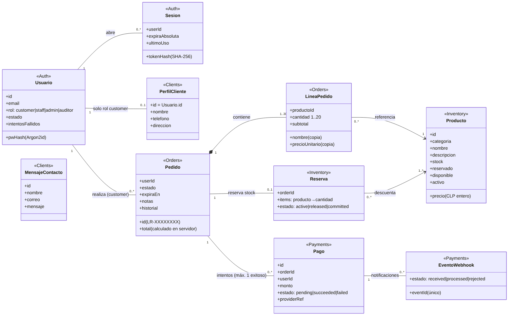

# Módulo 2 · Dominio, UML y reglas de negocio

Fuente editable: `docs/diagramas/dominio.mmd`. Cada entidad está marcada con el servicio dueño; **ningún servicio lee la base de otro**.

## Cardinalidades y su justificación

| Relación | Cardinalidad | Regla que la justifica |
|---|---|---|
| Usuario – Sesión | 1 a 0..* | Varias sesiones simultáneas (dispositivos); cada una se revoca por separado |
| Usuario – PerfilCliente | 1 a 0..1 | Solo el rol `customer` tiene perfil; el personal no lo necesita |
| Usuario – Pedido | 1 a 0..* | Un cliente puede tener muchos pedidos; al eliminar la cuenta los pedidos se **anonimizan** (se conservan por contabilidad) |
| Pedido – LineaPedido | 1 a 1..30 (composición) | Un pedido sin líneas no existe; máximo 30 líneas, cantidad 1–20, sin productos repetidos |
| LineaPedido – Producto | 0..* a 1 | La línea **copia** nombre y precio al crear el pedido: cambiar el precio después no altera pedidos existentes |
| Pedido – Reserva | 1 a 0..1 | Una reserva por pedido (idempotente por `order_id`) |
| Pedido – Pago | 1 a 0..* | Se permiten reintentos tras un rechazo; **como máximo un pago exitoso** |
| Pago – EventoWebhook | 1 a 0..* | `event_id` único: el mismo evento no se procesa dos veces |

## Reglas de negocio (RN)

| # | Regla | Dónde se aplica | Prueba |
|---|---|---|---|
| RN1 | Precios y total los calcula el servidor desde el catálogo vigente | orders | `test_V6_*`, `test_flujo_completo_*` |
| RN2 | Reserva atómica: `disponible ≥ cantidad` en todas las líneas o ninguna (compensación) | inventory | `test_concurrencia_*`, `test_stock_insuficiente_*` |
| RN3 | Un pedido sin pago vence a los 15 min (configurable) y libera su stock | orders | `test_expiracion_*` |
| RN4 | Pedido: `pending_reservation → awaiting_payment → paid → preparing → ready → delivered`; ramas `rejected`, `expired`, `cancelled`, `refund_required` | orders | `test_flujo_completo_*` |
| RN5 | Un pago que llega **después** de expirar el pedido lo marca `refund_required`; no se entrega | orders | `test_expiracion_*` |
| RN6 | Solo un resultado firmado, vigente (±300 s), de monto exacto y evento no repetido puede confirmar un pago | payments + orders | `test_V6_*` |
| RN7 | Un cliente solo ve sus pedidos; uno ajeno responde 404 (no revela su existencia) | orders | `test_V4_*` |
| RN8 | El rol lo guarda el servidor; el registro público siempre crea `customer` | auth | `test_registro_login_logout_y_cookie_segura`, `test_V3_*` |
| RN9 | La misma `Idempotency-Key` devuelve el mismo pedido; no se duplica | orders | `test_idempotency_key_*` |
| RN10 | El stock físico no puede bajar de lo reservado | inventory | `test_stock_fisico_no_baja_de_lo_reservado` |
| RN11 | Eliminar la cuenta borra perfil y credenciales y anonimiza pedidos | clients/auth/orders | `test_eliminar_cuenta_*` |
