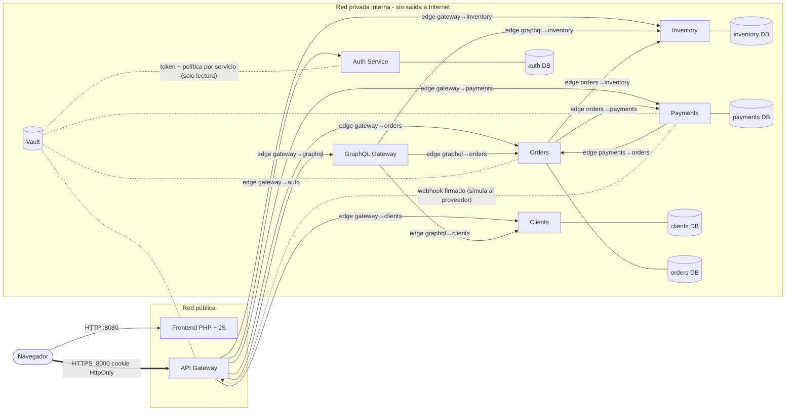
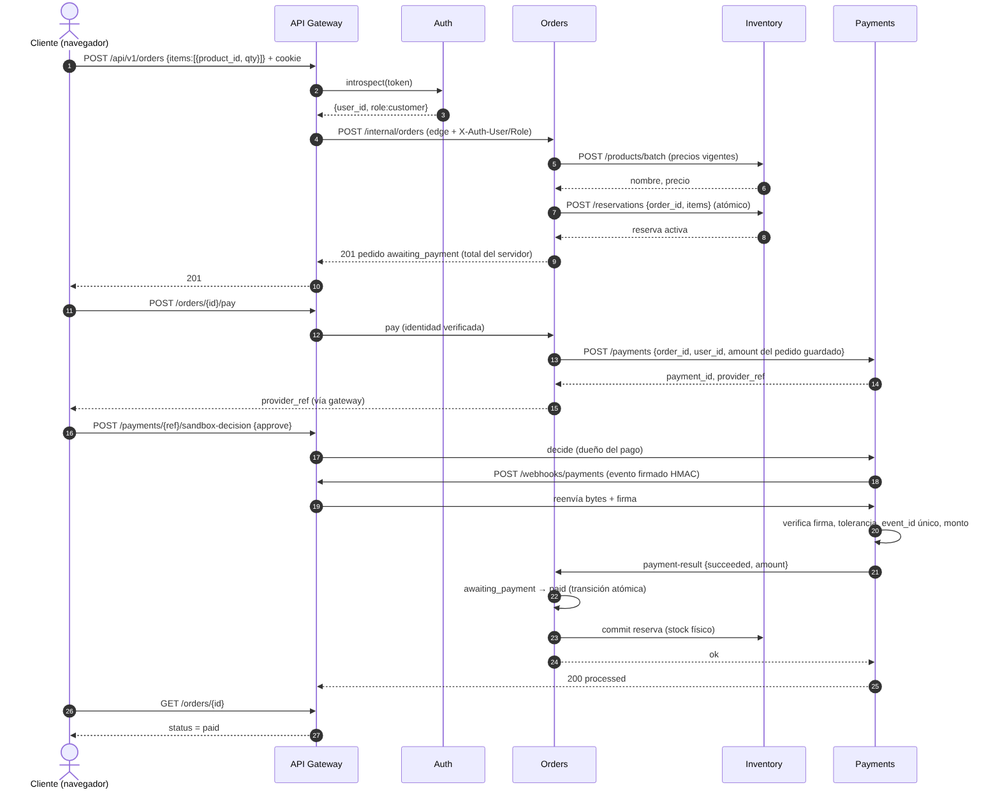

# Módulo 3 · Matriz de sistemas, mapa de componentes y secuencia

## Matriz de sistemas

| Sistema | Tipo | Quién lo llama | A quién llama | Protocolo | Credencial |
|---|---|---|---|---|---|
| Navegador | cliente externo | — | Gateway | HTTP/JSON + cookie `HttpOnly` | sesión del usuario |
| Proveedor de pagos (sandbox) | externo | — | Gateway (webhook) | HTTP + firma HMAC | `payments/webhook` |
| API Gateway | borde propio | navegador, proveedor | auth, clients, inventory, orders, payments, graphql | HTTP/JSON | `edge/gateway__*` |
| Auth | interno | gateway | — | HTTP/JSON | `edge/gateway__auth` |
| Clients | interno | gateway, graphql | — | HTTP/JSON | `edge/gateway__clients`, `edge/graphql__clients` |
| Inventory | interno | gateway, orders, graphql | — | HTTP/JSON | `edge/gateway__inventory`, `edge/orders__inventory`, `edge/graphql__inventory` |
| Orders | interno | gateway, payments, graphql | inventory, payments | HTTP/JSON | `edge/gateway__orders`, `edge/payments__orders`, `edge/graphql__orders` |
| Payments | interno | gateway, orders | orders | HTTP/JSON | `edge/gateway__payments`, `edge/orders__payments` |
| GraphQL | interno | gateway | orders, inventory, clients | HTTP/JSON (lectura) | `edge/gateway__graphql` |
| Vault | infraestructura | todos los servicios | — | HTTPS/JSON | token propio por servicio |
| MongoDB | infraestructura | los 5 servicios con datos | — | MongoDB wire (`mongodb://…`) | usuario propio por servicio |

La lista de aristas sale de `scripts/topology.py` (única fuente de verdad): de ella se generan el inventario de secretos, las políticas de Vault y las claves del arranque.

## Mapa de componentes

## Secuencia: compra, pago y confirmación

Puntos de diseño visibles en la secuencia: (1) el navegador nunca envía precio ni estado; (2) `orders` obtiene los precios de `inventory` en el momento; (3) el monto del pago sale del pedido guardado; (4) el «pagado» llega por un evento firmado, verificado dos veces (firma/monto/duplicado en `payments`; monto otra vez en `orders`); (5) `commit` de la reserva descuenta el stock físico solo al confirmar.

## Matriz de sistemas completa

| Sistema | Responsabilidad | Datos bajo su autoridad | Servicios asociados | Dependencias | Contrato de integración | Credencial o identidad | Respuesta ante fallos |
|---|---|---|---|---|---|---|---|
| **inventory** | catálogo, precios vigentes, stock y reservas | productos, stock, reservas (**decide** la disponibilidad) | S01 S02 S21 S22 S23 S24 | ninguna | `POST /internal/products/batch`, `/reservations` (atómico), `/commit`, `/release` | `edge/orders__inventory`, `edge/gateway__inventory`, `edge/graphql__inventory`; `db/inventory` | si no responde: crear pedido da **503 controlado** (no se acepta sin reservar); el catálogo y la compra fallan sin afectar al resto del sitio (`test_inventory_caido_*`) |
| **orders** | creación y ciclo de vida del pedido, reglas de transición, expiración | pedidos, líneas, historial de estados (**decide** el estado oficial) | S12 S13 S14 S15 S16 S26 | inventory, payments | REST interno; `payment-result` desde payments | `edge/gateway__orders`, `edge/payments__orders`, `edge/graphql__orders`, `edge/orders__*`; `db/orders` | si cae: 503 y se recupera al volver (`test_orders_caido_*`); `release_pending`/`commit_pending` se **reintentan** si inventory falló al liberar o confirmar; expiración periódica (`sweeper`) |
| **clients** | registro de perfil y acceso autorizado a datos del cliente; mensajes de contacto | perfiles, mensajes | S07 S08 S09 S10 S11 | ninguna | REST interno; `batch` para GraphQL | `edge/gateway__clients`, `edge/graphql__clients`; `db/clients` | si cae: el perfil y el campo `cliente` de GraphQL fallan **de forma parcial**; compras y pagos siguen |
| **payments** | inicio del pago, comprobación del resultado y relación con el proveedor | pagos, eventos de webhook (**decide** si un resultado es auténtico) | S17 S18 S19 | orders | `POST /internal/payments`; webhook firmado | `edge/gateway__payments`, `edge/orders__payments`, `payments/webhook` (HMAC); `db/payments` | un evento repetido se responde `duplicate` sin reprocesar; firma inválida → 401; si orders no responde, el pago vuelve a `pending`, se responde error y el proveedor puede **reintentar el mismo evento** (queda `received` y se reprocesa sin duplicar efectos) |
| **auth** | cuentas, contraseñas, sesiones | usuarios y sesiones | S03 S04 S05 S06 S25 | ninguna | `introspect` (gateway) | `edge/gateway__auth`; `db/auth` | si cae: **falla cerrado** (401/503), nunca se concede acceso (`test_auth_caido_*`) |
| **graphql** | agregación de lectura | ninguno (sin base) | S20 | orders, inventory, clients | queries internas con la identidad del usuario | `edge/gateway__graphql`, `edge/graphql__*` | errores **parciales** por campo; límite de tiempo por llamada |
| **proveedor de pagos** | cobrar | datos de tarjeta (**nunca llegan al sistema**) | — | — | webhook firmado | secreto compartido en Vault | en esta entrega es un **sandbox simulado** dentro de `payments` (ver Módulo 10) |

### Quién decide el estado oficial de cada recurso

Producto y stock → **inventory**; pedido y su estado → **orders**; pago y autenticidad del evento → **payments**, pero solo **orders** puede cambiar el estado del pedido a «pagado» (y vuelve a comprobar el monto); identidad y rol → **auth**; perfil → **clients**.

### Sistemas complementarios del caso (despacho, boletas, mensajería)

El caso Libre & Rico opera con **retiro en tienda**: no hay despacho. Tampoco se implementan boletas electrónicas ni mensajería (correo/WhatsApp) automáticas: se declaran **fuera del alcance de esta entrega** y como mejora futura (un servicio de notificaciones que consuma el estado del pedido). Son proveedores externos, no servicios propios. El pago se integra con un proveedor externo representado por un adaptador de prueba.
