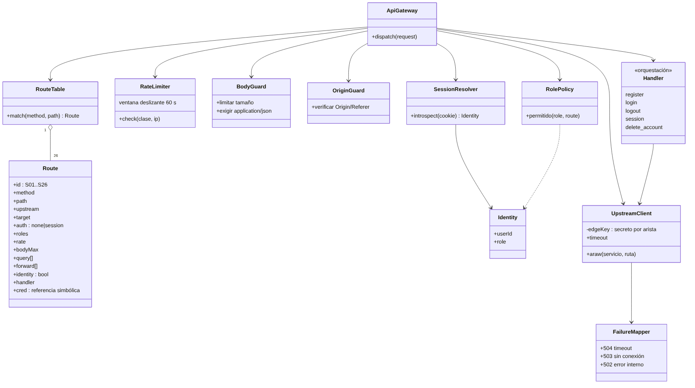
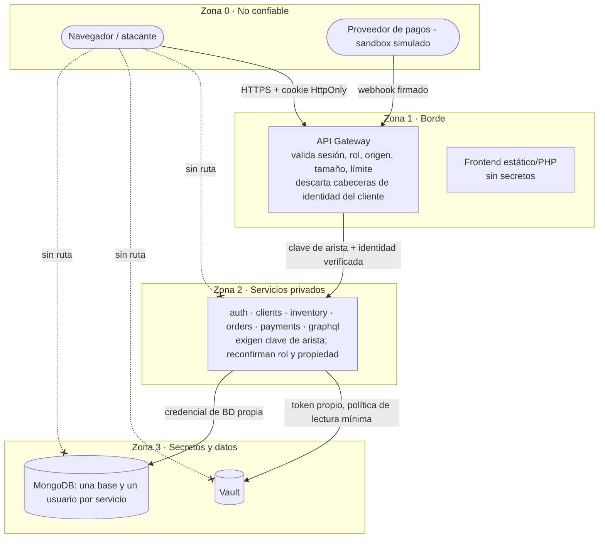

# Módulo 5 · API Gateway: UML y fronteras de confianza

## Diseño del gateway

Orden fijo de controles por solicitud (`backend/gateway/main.py`):

1. **Tabla de rutas explícita** (`routes.py`, S01–S26): lo que no está en la tabla responde 404/405; no existe «reenviar todo lo que empiece con /api».
2. **Límite de solicitudes** por clase de ruta e IP (login 20/min, contacto 5/min, escritura 60/min, públicas 240/min; configurables) → `429` con `retry_after`.
3. **Tamaño de cuerpo** máximo por ruta y `Content-Type: application/json` obligatorio → `413`/`415`.
4. **Origen (CSRF):** en métodos que modifican, `Origin`/`Referer` debe estar en la lista permitida; además la cookie es `SameSite=Lax`.
5. **Sesión:** la cookie `lr_session` se introspecciona en Auth en cada solicitud; el rol se lee **del usuario**, no de la sesión (un cambio de rol surte efecto de inmediato).
6. **Política de rol** por ruta → `401`/`403`.
7. **Reenvío mínimo:** solo cabeceras en lista blanca por ruta; se descartan `X-Auth-*` que traiga el cliente y se inyectan los verificados; se añade la clave de arista (`edge/gateway__<destino>`).
8. **Traducción de fallos:** `504` si el destino no responde a tiempo, `503` si no hay conexión, `502` si falla internamente; los 5xx controlados del destino (con `code`) se propagan sin exponer detalles.
9. **Cabeceras de seguridad** (`X-Content-Type-Options`, `Cache-Control: no-store`, etc.) y **CORS** con lista de orígenes explícita y `credentials`.

La cookie de sesión es `HttpOnly`, `SameSite=Lax`, `Path=/` y `Secure` cuando `LR_COOKIE_SECURE=1` (obligatorio tras TLS). El gateway **no almacena datos**: solo orquesta registro/ingreso/salida/eliminación de cuenta (Auth + Clients + Orders).

## Fronteras de confianza

| Frontera | Qué cruza | Control en la frontera |
|---|---|---|
| Z0 → Z1 (Internet → gateway) | todas las solicitudes del navegador y el webhook | tabla de rutas, límites, origen, sesión, rol, validación de tamaño y tipo |
| Z1 → Z2 (gateway → servicios) | solicitud + identidad verificada | clave de arista por llamador→destino (`hmac.compare_digest`); el servicio **re-verifica** rol y propiedad; identidad aceptada solo de gateway/graphql |
| Z2 → Z2 (servicio → servicio) | orders↔inventory, orders↔payments, graphql→(orders, inventory, clients) | solo las aristas listadas en `topology.py`; el resto devuelve 401 |
| Z2 → Z3 (servicios → Vault/Mongo) | secretos y datos | token de Vault de solo lectura por servicio; usuario de Mongo `readWrite` solo sobre su base |
| Webhook (Z0 → Z1 → payments) | evento del proveedor | firma HMAC-SHA256, tolerancia ±300 s, `event_id` único, monto exacto |

**Sin ruta (líneas punteadas):** desde Z0 no hay camino a servicios privados, MongoDB ni Vault: en compose solo se publican los puertos 8000 (gateway) y 8080 (front-end); la red `private` es `internal: true`. La prueba `test_V5_acceso_directo_al_backend_sin_identidad` verifica que llamar directo a un servicio sin identidad/clave falla.
